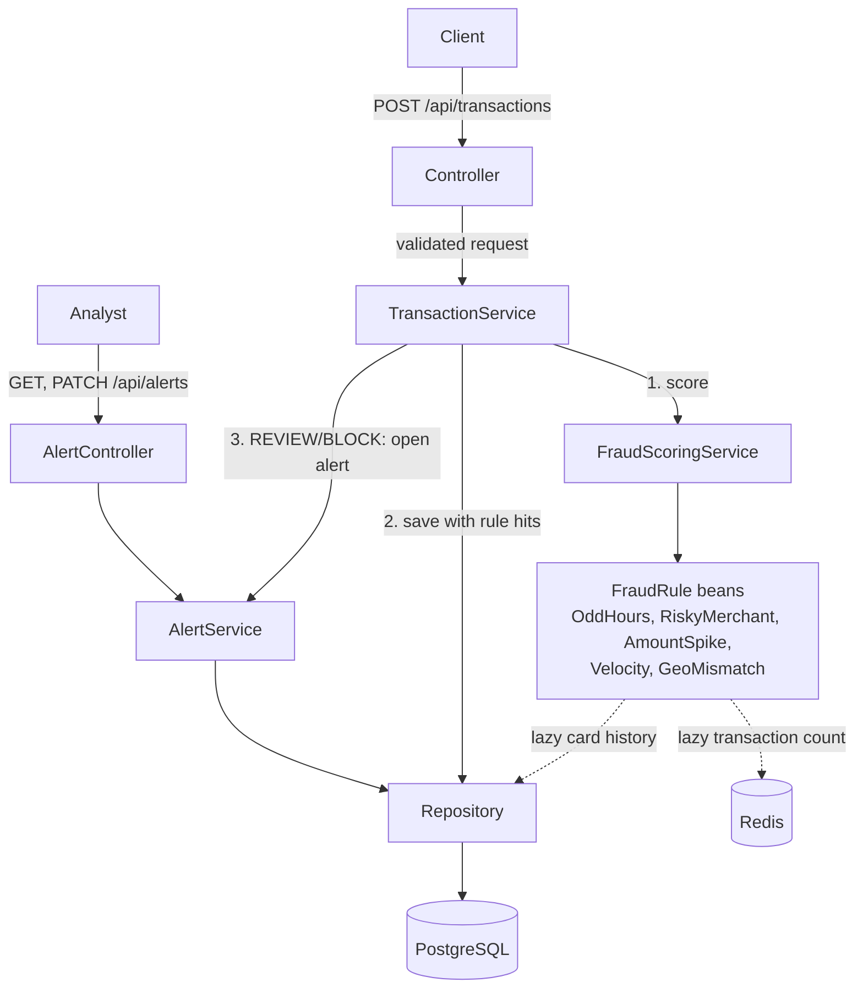

# Fraud Detection

[](https://github.com/PerumallaSG2/fraud-detection/actions/workflows/ci.yml)

A REST API that scores card transactions for fraud in real time. A client POSTs a transaction (card, amount,
merchant, category, location, timestamp). The service runs it through a set of rules, adds up the points of the
rules that fired into a risk score from 0 to 100, and returns a decision: APPROVE, REVIEW (a person should look at
it) or BLOCK. The score, decision and the rules that fired are stored in PostgreSQL, so every decision can be
retrieved and explained later. Every REVIEW or BLOCK opens an alert, which an analyst resolves as FRAUD or
FALSE_POSITIVE.

One Spring Boot application with a rules engine, PostgreSQL, and Redis for the velocity counter. There is no Kafka or ML yet.

## Architecture



- `controller`: HTTP, validation, error responses. It never touches repositories.
- `service`: `TransactionService` orchestrates; `FraudScoringService` runs the rules and maps the score to a decision;
  `AlertService` opens, lists and resolves alerts.
- `rules`: one class per rule, each implementing `FraudRule`. A new rule is a new class; the engine is unchanged.
- `repository`, `domain`: Spring Data JPA and the entities. DTOs are separate records and entities are never returned.

## Rules and scoring

Score is the sum of the points of triggered rules, capped at 100.

| Rule | Triggers when | Default points |
|---|---|---|
| `AMOUNT_SPIKE` | Amount is more than 3.0 x the average of the card's last 20 non-BLOCK transactions. With fewer than 5 such transactions, it triggers above 5000. | 40 |
| `RISKY_MERCHANT` | Merchant category is GAMBLING, CRYPTO or WIRE_TRANSFER (case-insensitive). | 30 |
| `ODD_HOURS` | Local hour is in [00:00, 05:00), read in the timestamp's own UTC offset. | 20 |
| `VELOCITY` | The card has more than 5 transactions in the 60 seconds ending at this transaction's timestamp, counting this one (so the 6th within 60s). Blocked attempts count. If Redis is down the rule does not fire (fails open). | 40 |
| `GEO_MISMATCH` | "Impossible travel": the distance from the card's previous non-BLOCK transaction (haversine), divided by the time between the two transactions' own timestamps, is above 900 km/h. Hops under 50 km never trigger. | 40 |

| Score | Decision |
|---|---|
| below 40 | APPROVE |
| 40 to 70 (both inclusive) | REVIEW |
| above 70 | BLOCK |

Points, thresholds, the score cap, the risky categories, the odd-hours window, the spike parameters, the velocity limit and window, and the geo-mismatch speed limit and minimum distance are all under
`fraud.*` in `src/main/resources/application.yml`.

## Tech stack

Java 21, Spring Boot 3.5.6, Maven, Spring Data JPA (Hibernate), Bean Validation, Flyway, PostgreSQL 16,
Redis 7 (Spring Data Redis, Lettuce), Spring Boot Actuator, Docker Compose. Tests use JUnit 5, Mockito, AssertJ
and Testcontainers (PostgreSQL, Redis).

## How to run

Needs Java 21, Maven and Docker. Redis must be running for velocity to count; without it the app still scores, but
the velocity rule never fires and a WARN is logged.

```
docker compose up -d --wait   # Postgres 16 on host port 5433, Redis 7 on host port 6380
mvn spring-boot:run           # app on localhost:8080; Flyway creates the schema
```

Score a transaction:

```
curl -i -X POST localhost:8080/api/transactions -H 'Content-Type: application/json' -d '{
  "cardId":"c1","amount":120.50,"merchant":"Casino","merchantCategory":"GAMBLING",
  "city":"Austin","latitude":30.27,"longitude":-97.74,"timestamp":"2026-10-25T02:30:00-05:00"}'
```

Response: `201 Created` with a `Location: /api/transactions/{id}` header and this body (copied from a run against
local Postgres; whitespace added):

```
{
  "id": "d24588fd-f85d-44b1-ae64-86d51a6b09ea",
  "cardId": "c1",
  "amount": 120.50,
  "merchant": "Casino",
  "merchantCategory": "GAMBLING",
  "city": "Austin",
  "latitude": 30.27,
  "longitude": -97.74,
  "timestamp": "2026-10-25T02:30:00-05:00",
  "riskScore": 50,
  "decision": "REVIEW",
  "triggeredRules": [
    {"rule": "ODD_HOURS", "points": 20, "reason": "Transaction at 02:30 local time is within odd hours (00:00-05:00)"},
    {"rule": "RISKY_MERCHANT", "points": 30, "reason": "Merchant category GAMBLING is high risk"}
  ],
  "createdAt": "2026-10-26T19:22:37.955980Z"
}
```

Fetch it again (`404` if unknown, `400` if the id is not a UUID):

```
curl localhost:8080/api/transactions/d24588fd-f85d-44b1-ae64-86d51a6b09ea
```

### Alerts

A REVIEW or BLOCK transaction opens an alert. List alerts newest first, optionally by status (`OPEN`, `FRAUD`,
`FALSE_POSITIVE`; all statuses if omitted). `page` starts at 0 and `size` is 1 to 100 (default 20):

```
curl 'localhost:8080/api/alerts?status=OPEN&page=0&size=20'
```

```
{
  "alerts": [
    {"id": "…", "transactionId": "…", "cardId": "c1", "riskScore": 50, "decision": "REVIEW",
     "status": "OPEN", "note": null, "createdAt": "…", "resolvedAt": null}
  ],
  "page": 0, "size": 20, "totalElements": 1, "totalPages": 1
}
```

Resolve an OPEN alert as `FRAUD` or `FALSE_POSITIVE`, with an optional note of up to 500 characters. The response is
the updated alert (`200`). An unknown id is `404`; an alert that is already resolved is `409`, and its first outcome is kept:

```
curl -X PATCH localhost:8080/api/alerts/{id} -H 'Content-Type: application/json' \
  -d '{"status":"FRAUD","note":"Cardholder confirmed the card was stolen"}'
```

Errors share one shape: `{status, error, message, fieldErrors}`, where `fieldErrors` is `[{field, message}]` and is
empty except for validation errors. Responses never include stack traces. Stop with `docker compose down`
(add `-v` to delete the data). DB settings can be overridden with `DB_HOST`, `DB_PORT`, `DB_USER`, `DB_PASSWORD`, and
Redis with `REDIS_HOST`, `REDIS_PORT`.

## Testing

`mvn test` runs 127 tests, all passing at the last run (0 skipped). It needs Docker: tests that touch the database run
against real PostgreSQL 16 (`postgres:16-alpine`, the same image as Docker Compose) and the velocity tests against
Redis, both through Testcontainers. Without Docker every container test fails rather than skips. Rule, service, mapper and
controller tests use no containers and take well under a second in total.

| Layer | Tests | Covers |
|---|---|---|
| Rules | 39 | Each rule's boundaries, offsets, case-insensitivity, history baseline, BLOCK exclusion; velocity limit, one count call, empty count; geo distance, speed limit, out-of-order timestamps |
| Scoring service | 11 | Point sum, rule order, cap at 100, decisions at 39/40/70/71, history lookup excludes BLOCK, velocity count and fail-open on Redis errors |
| Transaction service and mapper | 11 | Scoring happens before save, same id scored and saved, rule hits, alert opened after save, 404, 2-decimal amounts |
| Alert service | 8 | REVIEW/BLOCK open an alert and APPROVE doesn't, newest-first paging with and without status, resolve, 404, 409 keeps the first outcome |
| Repositories (`@DataJpaTest`, real PostgreSQL) | 8 | Save/load with ordered rule hits, offset round trip, history query; alert save/load, status filter with newest-first paging, one alert per transaction |
| Velocity counter (`@DataRedisTest`, real Redis) | 9 | Window bounds, transaction timestamps, cards isolated, same id counted once, old entries dropped, TTL |
| Controllers (`@WebMvcTest`) | 23 | 201 and `Location`, 400 cases, 404, 405, 500 without leaked details; alert list params and shape, PATCH 200/400/404/409 |
| End to end (`@SpringBootTest`, real HTTP and PostgreSQL) | 7 | POST/GET round trip and rule order, spike scenario, blocked baseline, impossible travel (velocity mocked) |
| Alerts end to end (real HTTP and PostgreSQL) | 6 | REVIEW and BLOCK open alerts, APPROVE doesn't, newest first, resolve then 409, 404; a failing alert rolls back the transaction |
| Velocity end to end (real HTTP, PostgreSQL and Redis) | 3 | 6th within 60s fires and reviews, timestamp not server time, blocked attempts count |
| Application context | 2 | Context loads, health endpoint |

Every database test runs Flyway's V1 to V3 on a fresh PostgreSQL 16 and Hibernate validates the schema against it,
so the suite checks the same SQL and types that production uses. Each distinct Spring test context starts its own
container.

## Key design decisions

- **Blocked transactions are excluded from the spike baseline.** A fraudulent amount that was blocked must not raise
  the average and make the next large amount look normal. An end-to-end test covers this.
- **Score before save.** The transaction is scored first and saved after, in one `@Transactional` method, so it
  never counts toward its own baseline.
- **Lazy history in `RuleContext`.** Rules do not inject repositories. The context carries a lookup function that
  runs the query only if a rule asks for history. It is always built with the BLOCK-excluding query.
- **Local offset for odd hours.** 02:30 at -05:00 is 02:30 for the cardholder, not 07:30 UTC. Jackson's default
  conversion to UTC is turned off, and V2 stores the original offset, so GET returns the timestamp as submitted.
- **Amounts with more than 2 decimals are rejected (400), not rounded,** so the scored amount and the stored amount
  are always identical.
- **Flyway owns the schema.** Hibernate only validates. Schema changes are new `V<n>` files; applied ones are never edited.
- **Thresholds live in one place** (`FraudProperties`, bound from `application.yml`), not in rules or services.
- **Velocity fails open.** If Redis is down, the velocity rule is skipped with a WARN and the other rules still
  score, so a cache outage doesn't decline every customer. The health endpoint shows Redis as down.
- **Velocity counts blocked attempts.** Card testing is many fast attempts that get blocked, so they must count.
  This is the opposite of the spike baseline, which excludes them.
- **Alerts are saved in the same database transaction as the scored transaction.** If the alert can't be saved,
  the transaction isn't either, so there is never a REVIEW/BLOCK without an alert. Item 4 (Kafka) will move alert
  creation into a consumer; until then it is one call, `AlertService.openIfFlagged`.
- **Alerts copy the card, score and decision** from their transaction, so the list needs no join. One alert per
  transaction (unique `transaction_id`).
- **An alert is resolved once.** Resolving locks the row (`SELECT ... FOR UPDATE`), so of two concurrent resolves the
  second gets `409`. `OPEN` is not a valid resolution.
- **One id per transaction.** The id is generated before scoring and used as both the Redis entry and the database
  key. The Redis update runs as one Lua script, so concurrent requests for the same card can't miscount. Known limit:
  if the save fails after scoring, that attempt stays counted for up to 60 seconds.

## Roadmap

Not built yet:

- Client idempotency key, so a retried request is not scored, counted or stored twice
- Kafka, splitting ingestion and scoring into separate services
- AI-generated explanations of decisions with Ollama (Bedrock optional)
- Prometheus and Grafana monitoring
- k6 load tests
- Replaying a Kaggle fraud dataset through the API

