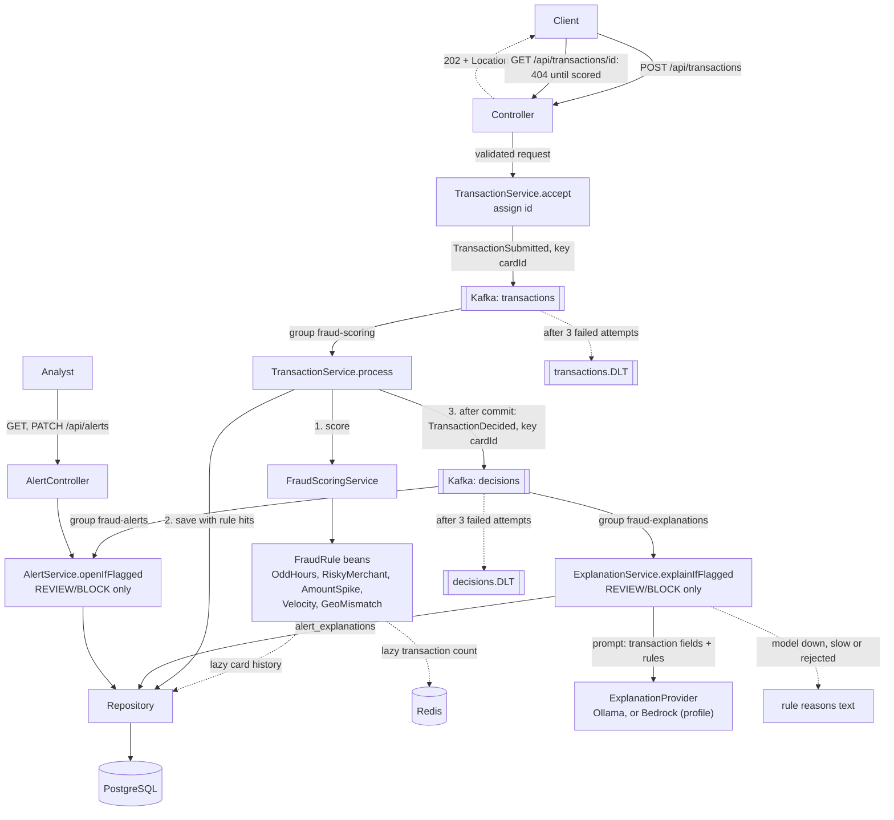

# Fraud Detection

[](https://github.com/PerumallaSG2/fraud-detection/actions/workflows/ci.yml)

A REST API that scores card transactions for fraud. A client POSTs a transaction (card, amount, merchant,
category, location, timestamp); it is queued on Kafka and the API answers `202 Accepted` right away. A consumer runs
it through a set of rules, adds up the points of the rules that fired into a risk score from 0 to 100, and decides:
APPROVE, REVIEW (a person should look at it) or BLOCK. The score, decision and the rules that fired are stored in
PostgreSQL, where the client fetches them. Every REVIEW or BLOCK opens an alert, which an analyst resolves as FRAUD or
FALSE_POSITIVE, and gets a short plain-English explanation written by an LLM (Ollama locally, or Claude on Amazon
Bedrock), or built from the rule reasons when no model is available. The AI explains; it never decides.

One Spring Boot application with a rules engine, Kafka between ingestion, scoring, alerts and explanations,
PostgreSQL, and Redis for the velocity counter.

## Architecture



- `controller`: HTTP, validation, error responses. It never touches repositories.
- `messaging`: the events, topic names, the publisher, and three thin listeners that hand each message to a service
  (the role a controller plays for HTTP).
- `service`: `TransactionService` accepts (publishes) and processes (scores, saves, publishes the decision);
  `FraudScoringService` runs the rules and maps the score to a decision; `AlertService` opens, lists and resolves
  alerts; `ExplanationService` writes each flagged transaction's explanation.
- `explanation`: the `ExplanationProvider` interface, its Ollama and Bedrock implementations, the prompt builder,
  the output checks and the rule-reasons fallback.
- `rules`: one class per rule, each implementing `FraudRule`. A new rule is a new class; the engine is unchanged.
- `repository`, `domain`: Spring Data JPA and the entities. DTOs are separate records and entities are never returned.

## Rules and scoring

Score is the sum of the points of triggered rules, capped at 100.

| Rule | Triggers when | Default points |
|---|---|---|
| `AMOUNT_SPIKE` | Amount is more than 3.0 x the average of the card's last 20 non-BLOCK transactions. With fewer than 5 such transactions, it triggers above 5000. | 40 |
| `RISKY_MERCHANT` | Merchant category is GAMBLING, CRYPTO or WIRE_TRANSFER (case-insensitive). | 30 |
| `ODD_HOURS` | Local hour is in [00:00, 05:00), read in the timestamp's own UTC offset. | 20 |
| `VELOCITY` | The card has more than 5 transactions in the 60 seconds ending at this transaction's timestamp, counting this one (so the 6th within 60s). Blocked attempts count. If Redis is down the rule does not fire (fails open). | 40 |
| `GEO_MISMATCH` | "Impossible travel": the distance from the card's previous non-BLOCK transaction (haversine), divided by the time between the two transactions' own timestamps, is above 900 km/h. Hops under 50 km never trigger. | 40 |

| Score | Decision |
|---|---|
| below 40 | APPROVE |
| 40 to 70 (both inclusive) | REVIEW |
| above 70 | BLOCK |

Points, thresholds, the score cap, the risky categories, the odd-hours window, the spike parameters, the velocity limit and window, and the geo-mismatch speed limit and minimum distance are all under
`fraud.*` in `src/main/resources/application.yml`.

## Tech stack

Java 21, Spring Boot 3.5.6, Maven, Spring Data JPA (Hibernate), Bean Validation, Flyway, PostgreSQL 16,
Redis 7 (Spring Data Redis, Lettuce), Apache Kafka 3.9 (Spring for Apache Kafka; one KRaft node, `apache/kafka`
image), Ollama (`llama3.2:1b`, optional), AWS SDK for Java 2 (`bedrockruntime`, Converse API, only with the
`bedrock` profile), Spring Boot Actuator, Docker Compose. Tests use JUnit 5, Mockito, AssertJ, Awaitility and Testcontainers
(PostgreSQL, Redis, Kafka).

## How to run

Needs Java 21, Maven and Docker. Kafka must be running to accept transactions (without it POST returns `503`).
Redis must be running for velocity to count; without it the app still scores, but the velocity rule never fires and
a WARN is logged. Ollama is optional: without it, explanations are built from the rule reasons (see
[Explanations](#explanations)).

```
docker compose up -d --wait   # Postgres 16 on host port 5433, Redis 7 on 6380, Kafka on 9094
mvn spring-boot:run           # app on localhost:8080; Flyway creates the schema, the app creates the topics
```

Submit a transaction:

```
curl -i -X POST localhost:8080/api/transactions -H 'Content-Type: application/json' -d '{
  "cardId":"c1","amount":120.50,"merchant":"Casino","merchantCategory":"GAMBLING",
  "city":"Austin","latitude":30.27,"longitude":-97.74,"timestamp":"2026-10-25T02:30:00-05:00"}'
```

Response: `202 Accepted` with a `Location` header. The transaction is queued, not scored yet (copied from a run
against local Docker Compose):

```
HTTP/1.1 202
Location: http://localhost:8080/api/transactions/6fd73df6-d22e-4cf6-b629-3ef46ddedb74

{"id":"6fd73df6-d22e-4cf6-b629-3ef46ddedb74","status":"PENDING"}
```

`202` is sent only after Kafka has acknowledged the write (`acks=all`), so an accepted transaction is not lost. If
Kafka can't be reached, POST returns `503` ("Transaction could not be accepted, try again") within about 3 seconds
and nothing is queued, so the client can retry. A `400` (validation) publishes nothing.

Poll the `Location`. It is `404` until the transaction is scored (usually a few milliseconds; in that run the 5th
poll, 50 ms apart, got it), then `200` with the decision (`400` if the id is not a UUID):

```
curl localhost:8080/api/transactions/6fd73df6-d22e-4cf6-b629-3ef46ddedb74
```

```
{
  "id": "6fd73df6-d22e-4cf6-b629-3ef46ddedb74",
  "cardId": "c1",
  "amount": 120.50,
  "merchant": "Casino",
  "merchantCategory": "GAMBLING",
  "city": "Austin",
  "latitude": 30.27,
  "longitude": -97.74,
  "timestamp": "2026-10-25T02:30:00-05:00",
  "riskScore": 50,
  "decision": "REVIEW",
  "triggeredRules": [
    {"rule": "RISKY_MERCHANT", "points": 30, "reason": "Merchant category GAMBLING is high risk"},
    {"rule": "ODD_HOURS", "points": 20, "reason": "Transaction at 02:30 local time is within odd hours (00:00-05:00)"}
  ],
  "createdAt": "2026-10-31T18:51:21.890440Z"
}
```

A `404` means "not scored yet", "unknown id" or "dead-lettered" (see below); the API doesn't tell them apart. There is
no PENDING row in the database: writing one would put PostgreSQL back on the POST path and make POST write to two
systems that can disagree.

### Alerts

A REVIEW or BLOCK transaction opens an alert, a moment after the transaction is scored (a separate consumer reads
the decision from Kafka). Each alert carries its `explanation` once one is written ([Explanations](#explanations)). List alerts newest first, optionally by status (`OPEN`, `FRAUD`,
`FALSE_POSITIVE`; all statuses if omitted). `page` starts at 0 and `size` is 1 to 100 (default 20):

```
curl 'localhost:8080/api/alerts?status=OPEN&page=0&size=20'
```

```
{
  "alerts": [
    {"id": "2a4cc410-3208-4763-a891-7598dd568eff", "transactionId": "5959ab81-d710-4c6e-8371-eb1d434e351b",
     "cardId": "c5", "riskScore": 50, "decision": "REVIEW", "status": "OPEN", "note": null,
     "createdAt": "2026-10-31T19:42:07.435504Z", "resolvedAt": null,
     "explanation": {
       "text": "Flagged for REVIEW (score 50): Merchant category GAMBLING is high risk; Transaction at 02:30 local time is within odd hours (00:00-05:00).",
       "source": "RULES", "model": null, "createdAt": "2026-10-31T19:42:07.473143Z"}},
    {"id": "1a8608ca-8461-4bd2-aefc-461d7a720083", "transactionId": "6fd73df6-d22e-4cf6-b629-3ef46ddedb74",
     "cardId": "c1", "riskScore": 50, "decision": "REVIEW", "status": "OPEN", "note": null,
     "createdAt": "2026-10-31T18:51:21.947538Z", "resolvedAt": null, "explanation": null}
  ],
  "page": 0, "size": 20, "totalElements": 2, "totalPages": 1
}
```

(Copied from a run without Ollama, hence `RULES`. The second alert was created before explanations existed; see
[alerts created before explanations](#alerts-created-before-explanations).)

Resolve an OPEN alert as `FRAUD` or `FALSE_POSITIVE`, with an optional note of up to 500 characters. The response is
the updated alert (`200`). An unknown id is `404`; an alert that is already resolved is `409`, and its first outcome is kept:

```
curl -X PATCH localhost:8080/api/alerts/{id} -H 'Content-Type: application/json' \
  -d '{"status":"FRAUD","note":"Cardholder confirmed the card was stolen"}'
```

Errors share one shape: `{status, error, message, fieldErrors}`, where `fieldErrors` is `[{field, message}]` and is
empty except for validation errors. Responses never include stack traces. Stop with `docker compose down`
(add `-v` to delete the data). DB settings can be overridden with `DB_HOST`, `DB_PORT`, `DB_USER`, `DB_PASSWORD`, and
Redis with `REDIS_HOST`, `REDIS_PORT`, and Kafka with `KAFKA_HOST`, `KAFKA_PORT` (default 9094, so it doesn't clash
with a local Kafka on 9092). Kafka keeps no volume: topics and offsets are gone after `docker compose down`.

## Explanations

Every REVIEW or BLOCK transaction gets a short plain-English explanation for the analyst, returned inside its alert
(`GET /api/alerts`, `PATCH /api/alerts/{id}`) as `explanation: {text, source, model, createdAt}`:

| `source` | Written by | `model` |
|---|---|---|
| `OLLAMA` | A local model through Ollama's HTTP API (default) | `llama3.2:1b` |
| `BEDROCK` | A model on Amazon Bedrock through the Converse API (`bedrock` profile) | e.g. `global.anthropic.claude-haiku-5-5` |
| `RULES` | No model: the decision, score and rule reasons, joined | `null` |

- **AI explains, never decides.** Explanations are written by their own consumer group on `decisions`
  (`fraud-explanations`), after the transaction is scored and saved. Nothing on the scoring path calls a model, so
  scoring speed and decisions don't depend on one, and the explanation code can only read transactions and write
  `alert_explanations`: it can't change a score, a decision or an alert. A hanging model delays only explanations
  (an end-to-end test checks that scoring and the alert are unaffected).
- **Always an explanation.** If the model isn't running (connection refused at once), times out (5 s for Ollama,
  10 s for Bedrock), errors, is cut off or refuses, or its answer is rejected, the explanation is built from the rule
  reasons instead (`RULES`). So the app works without any model.
- **Prompt.** Only the transaction's fields (amount, merchant, category, city, local time, score, decision) and its
  triggered rules with their reasons. No card or transaction id.
- **Prompt injection.** Merchant, city and the rule reasons come from the client (the geo-mismatch reason contains
  both cities), so they are untrusted: control characters and newlines are stripped, each is capped (100 characters,
  300 for a reason), and they are sent as one JSON block, so a quote or newline can't break out of its string. The
  fixed instructions say the block is data and never instructions, and that the decision and score are final.
- **Output checks.** Whitespace is collapsed and the text capped at 500 characters (at a sentence or word
  boundary). An answer is rejected, and the rule reasons used, if it is blank, contains a link, mentions approving, or
  says "blocked" for a REVIEW, so a model can't contradict the decision.
- **Idempotent.** One explanation per transaction (primary key `transaction_id`); a redelivered decision is skipped.
  Explanations have their own table, keyed by transaction, because the alert and explanation consumers aren't ordered
  relative to each other, but the transaction always exists first. The alert list fetches a page's explanations in one
  extra query.

### Ollama (default)

```
ollama pull llama3.2:1b   # about 1.3 GB; not in Docker Compose, to save disk (and native is faster on a Mac)
ollama serve              # if it isn't already running as an app; then mvn spring-boot:run as usual
```

Settings are under `fraud.explanations.ollama` (`OLLAMA_URL`, default `http://localhost:11434`). The first request
after Ollama starts loads the model and can exceed the 5 s timeout; that one explanation falls back to `RULES`, and
`keep_alive` keeps the model loaded afterwards.

### Amazon Bedrock (optional)

```
SPRING_PROFILES_ACTIVE=bedrock AWS_REGION=us-east-1 mvn spring-boot:run
```

- The default model is **Claude Haiku 5.5**, the cheapest Claude model on Bedrock, through its global cross-Region
  inference profile `global.anthropic.claude-haiku-5-5`. AWS doesn't offer it with in-Region invocation, and the
  global profile has no regional pricing premium. Its access has to be enabled in the Bedrock console (Model access).
- The provider uses the **Converse API**, which AWS lists as supported for Claude Haiku 5.5 on the `bedrock-runtime`
  endpoint, and sends nothing model-specific (no temperature, no extra fields). So any Converse model works by changing
  `fraud.explanations.bedrock.model-id` (or `BEDROCK_MODEL_ID`), with no code change.
- Credentials come from the default AWS chain (environment, profile, SSO, instance role). One retry at most, within
  the 10 s timeout. Only text blocks of the answer are used; a reasoning block is skipped, and any stop other than
  `end_turn` (`max_tokens`, `content_filtered`, `guardrail_intervened`) falls back to `RULES`.

### Alerts created before explanations

There is no backfill migration, since explanations need a model call rather than SQL. The new consumer group starts at
the earliest retained offset, so on its first start it explains every REVIEW/BLOCK decision still in `decisions`
(Kafka keeps 7 days by default). Alerts whose decisions are no longer retained keep `explanation: null`. Locally the
Kafka container has no volume, so after it is recreated (`docker compose down`, or compose recreating it) old
decisions are gone; that is why the second alert above has none. Within retention, a manual backfill is safe
(the consumer is idempotent):

```
docker exec fraud-kafka /opt/kafka/bin/kafka-consumer-groups.sh --bootstrap-server localhost:9092 \
  --group fraud-explanations --topic decisions --reset-offsets --to-earliest --execute   # with the app stopped
```

`explanation: null` on a new alert means it is not written yet (usually milliseconds after the alert, up to the
model timeout).

## Delivery guarantees

- **At least once.** The scoring consumer commits a message's offset only after it has scored, saved and published
  the decision. A crash or failure anywhere before that redelivers the message.
- **Idempotent consumers.** A redelivered transaction whose id is already saved is not scored or saved again; its
  decision is just published again (in case the earlier attempt saved and then failed to publish). The alert consumer
  skips decisions whose transaction already has an alert, and the unique `transaction_id` stops a racing duplicate.
  The Redis velocity entry is keyed by transaction id, so a retry isn't counted twice.
- **Decision after commit.** `decisions` is published only after the transaction row commits, so the alert consumer
  always finds the row (the alert has a foreign key to it). No outbox table is needed: redelivery covers a lost
  publish.
- **Retry, then dead-letter.** A failing message is retried in place 3 times in total, 1 second apart; then it goes to
  `<topic>.DLT` (same partition, with the exception and original offset in its headers), an ERROR is logged and the
  partition moves on. A message that can't be deserialized goes there at once. A dead-lettered transaction stays
  `404`. Replaying a DLT is manual for now.
- **Explanations** follow the same rules: their consumer is idempotent and shares the retry and dead-letter handling
  (a failed record goes to `decisions.DLT` with its consumer group in the headers, so a replay targets only
  `fraud-explanations`). A model failure never reaches the retries: it falls back to the rule reasons instead. At most
  10 records per poll, so even a model hanging to its timeout on each can't push a poll past
  `max.poll.interval.ms` and trigger a rebalance.
- **Per-card ordering.** Both topics are keyed by card id, so one card's messages share a partition, and each
  partition is consumed by one thread in offset order. The producer is idempotent, so its own retries can't reorder,
  and retries are blocking (no retry topics), so a failing message can't be overtaken. This matters because the spike
  baseline and geo mismatch read the card's previously saved transactions: the results match what a synchronous API
  would give for the same arrival order. Across cards nothing is ordered, and nothing needs it. Changing the
  partition count (`fraud.messaging.partitions`, 3) of existing topics re-maps cards and breaks this once.

### Trade-offs of going asynchronous

Gains: POST's latency and availability depend only on Kafka, not on PostgreSQL, Redis or scoring cost; bursts queue
in Kafka instead of piling onto the database; scoring scales with partitions and consumers; a failing alert no
longer fails or rolls back scoring; events can be replayed, and new consumers can subscribe without touching POST.

Costs:

- The caller doesn't get the decision in the response and has to poll. That suits post-authorization monitoring,
  not inline card authorization, which needs a synchronous answer.
- Eventual consistency: GET is `404` briefly, and alerts lag behind transactions. Before, a transaction and its
  alert were one database transaction; now they are joined by redelivery.
- At-least-once delivery makes every consumer idempotent.
- Poison messages and outages land in a DLT that someone has to watch and replay. Known limit: a long database
  outage dead-letters everything that arrives during it, not only bad messages.
- Blocking retries hold up a failing message's partition (about a third of the cards) for about 2 seconds.
- One more piece of infrastructure (about 217 MB of image, a 256 MB heap) and slower, asynchronous tests.

## Testing

`mvn test` runs 178 tests, all passing at the last run (0 skipped). It needs Docker: tests that touch the database run
against real PostgreSQL 16 (`postgres:16-alpine`, the same image as Docker Compose), the full-app tests also against
Kafka (`apache/kafka:3.9.2`, same as Compose) and the velocity tests against Redis, all through Testcontainers.
Without Docker every container test fails rather than skips. No test needs Ollama or AWS: both are replaced by a
local stub HTTP server (the JDK's built-in `HttpServer`), and the Bedrock tests run the real AWS SDK client against
it with fake credentials. Rule, service, mapper, explanation and controller tests use no containers and take well
under a second in total.

| Layer | Tests | Covers |
|---|---|---|
| Rules | 39 | Each rule's boundaries, offsets, case-insensitivity, history baseline, BLOCK exclusion; velocity limit, one count call, empty count; geo distance, speed limit, out-of-order timestamps |
| Scoring service | 11 | Point sum, rule order, cap at 100, decisions at 39/40/70/71, history lookup excludes BLOCK, velocity count and fail-open on Redis errors |
| Transaction service and mapper | 11 | Accept publishes under the returned id, publish failure propagates; process scores then saves then publishes after commit, rule hits, an already saved id is not rescored but republished, scoring failure saves and publishes nothing; 404, 2-decimal amounts |
| Alert service | 12 | REVIEW/BLOCK open an alert and APPROVE doesn't, a redelivered decision opens no second alert, newest-first paging with and without status, explanations added with one lookup per page (none for an empty page), resolve returns the explanation, 404, 409 keeps the first outcome |
| Explanations (no containers) | 33 | Prompt has only transaction fields and rules, no ids; injected quotes and newlines stay inside their JSON string; caps; output cleaning, 500-character cap, rejecting blank, links, approval, "blocked" for a REVIEW; rule-reasons text; service: APPROVE and already-explained skipped, model answer saved with source and model, failure or rejected answer falls back, never changes the transaction; Ollama against a stub (request body, 500, no answer, timeout, not running); Bedrock Converse against a stub (path, body without temperature, reasoning skipped, non-`end_turn` stops, errors); exactly one provider per profile |
| Repositories (`@DataJpaTest`, real PostgreSQL) | 11 | Save/load with ordered rule hits, offset round trip, history query; alert save/load, status filter with newest-first paging, one alert per transaction, exists by transaction; explanation save/load, a second one for the same transaction rejected (not merged) |
| Velocity counter (`@DataRedisTest`, real Redis) | 9 | Window bounds, transaction timestamps, cards isolated, same id counted once, old entries dropped, TTL |
| Controllers (`@WebMvcTest`) | 25 | 202 with `Location` and PENDING body, 503 when Kafka doesn't accept, 400 cases (nothing published), 404, 405, 500 without leaked details; alert list params and shape with and without an explanation, PATCH 200/400/404/409 |
| End to end (`@SpringBootTest`, real HTTP, Kafka and PostgreSQL) | 7 | POST 202 then GET round trip, offset kept through Kafka, rule order, spike scenario, blocked baseline, impossible travel (velocity mocked) |
| Alerts end to end (real HTTP, Kafka and PostgreSQL) | 5 | REVIEW and BLOCK open alerts, APPROVE doesn't, newest first, resolve then 409, 404 |
| Explanations end to end (real HTTP, Kafka, PostgreSQL, Ollama stub) | 5 | REVIEW explained by the model with score and decision unchanged; an Ollama error and a contradicting answer fall back to the rule reasons; a hanging model delays neither scoring nor the alert; APPROVE gets none |
| Kafka processing (real Kafka and PostgreSQL) | 5 | A duplicated message is scored, saved and alerted once; a transient failure is retried with nothing dead-lettered; a permanent one is dead-lettered after 3 attempts and the partition moves on; unreadable JSON is dead-lettered unscored; one card's 10 transactions are processed in order |
| Velocity end to end (real HTTP, Kafka, PostgreSQL and Redis) | 3 | 6th within 60s fires and reviews, timestamp not server time, blocked attempts count |
| Application context | 2 | Context loads, health endpoint |

Every database test runs Flyway's V1 to V4 on a fresh PostgreSQL 16 and Hibernate validates the schema against it,
so the suite checks the same SQL and types that production uses. Each distinct Spring test context starts its own
containers. The full-app tests share one context (`AbstractKafkaIntegrationTest`, which also owns the one Ollama
stub), so one Kafka serves them all; the velocity tests have their own (real Redis), and with it their own Kafka, so
the two contexts' consumers never take each other's messages. That context points Ollama at a closed port, so its
explanations fall back to the rule reasons.

## Key design decisions

- **Blocked transactions are excluded from the spike baseline.** A fraudulent amount that was blocked must not raise
  the average and make the next large amount look normal. An end-to-end test covers this.
- **Score before save.** The transaction is scored first and saved after, in one database transaction, so it
  never counts toward its own baseline.
- **Lazy history in `RuleContext`.** Rules do not inject repositories. The context carries a lookup function that
  runs the query only if a rule asks for history. It is always built with the BLOCK-excluding query.
- **Local offset for odd hours.** 02:30 at -05:00 is 02:30 for the cardholder, not 07:30 UTC. Jackson's default
  conversion to UTC is turned off, and V2 stores the original offset, so GET returns the timestamp as submitted.
- **Amounts with more than 2 decimals are rejected (400), not rounded,** so the scored amount and the stored amount
  are always identical.
- **Flyway owns the schema.** Hibernate only validates. Schema changes are new `V<n>` files; applied ones are never edited.
- **Thresholds live in one place** (`FraudProperties`, bound from `application.yml`), not in rules or services.
- **Velocity fails open.** If Redis is down, the velocity rule is skipped with a WARN and the other rules still
  score, so a cache outage doesn't decline every customer. The health endpoint shows Redis as down.
- **Velocity counts blocked attempts.** Card testing is many fast attempts that get blocked, so they must count.
  This is the opposite of the spike baseline, which excludes them.
- **Alerts are opened by a Kafka consumer of `decisions`,** not in the scoring transaction. A failing alert no
  longer rolls back the transaction; instead the decision is retried and, after 3 attempts, dead-lettered to
  `decisions.DLT`, where it can be replayed.
- **Kafka's JSON uses the application's `ObjectMapper`.** spring-kafka's own mapper would shift timestamps to UTC
  and break odd hours; an end-to-end test checks the offset survives.
- **Alerts copy the card, score and decision** from their transaction, so the list needs no join (only one extra
  query per page for the explanations). One alert per transaction (unique `transaction_id`).
- **An alert is resolved once.** Resolving locks the row (`SELECT ... FOR UPDATE`), so of two concurrent resolves the
  second gets `409`. `OPEN` is not a valid resolution.
- **One id per transaction.** The id is generated before scoring and used as both the Redis entry and the database
  key. The Redis update runs as one Lua script, so concurrent requests for the same card can't miscount. Known limit:
  if the save fails after scoring and the message ends up dead-lettered, that attempt stays counted for up to 60
  seconds. (A retry that succeeds isn't counted twice: same id.)

## Roadmap

Not built yet:

- Client idempotency key, so a retried request is not scored, counted or stored twice
- Splitting ingestion, scoring and alerts into separate deployable services (they are already decoupled by Kafka)
- Replaying dead-lettered messages
- Prometheus and Grafana monitoring
- k6 load tests
- Replaying a Kaggle fraud dataset through the API

