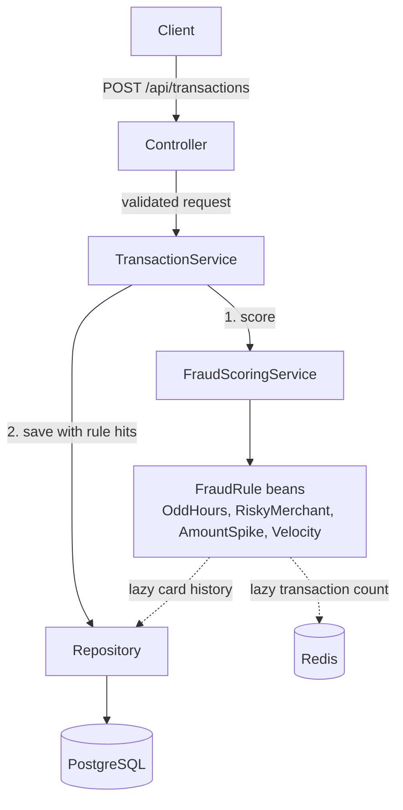

# Fraud Detection

[](https://github.com/PerumallaSG2/fraud-detection/actions/workflows/ci.yml)

A REST API that scores card transactions for fraud in real time. A client POSTs a transaction (card, amount,
merchant, category, location, timestamp). The service runs it through a set of rules, adds up the points of the
rules that fired into a risk score from 0 to 100, and returns a decision: APPROVE, REVIEW (a person should look at
it) or BLOCK. The score, decision and the rules that fired are stored in PostgreSQL, so every decision can be
retrieved and explained later.

One Spring Boot application with a rules engine, PostgreSQL, and Redis for the velocity counter. There is no Kafka or ML yet.

## Architecture



- `controller`: HTTP, validation, error responses. It never touches repositories.
- `service`: `TransactionService` orchestrates; `FraudScoringService` runs the rules and maps the score to a decision.
- `rules`: one class per rule, each implementing `FraudRule`. A new rule is a new class; the engine is unchanged.
- `repository`, `domain`: Spring Data JPA and the entities. DTOs are separate records and entities are never returned.

## Rules and scoring

Score is the sum of the points of triggered rules, capped at 100.

| Rule | Triggers when | Default points |
|---|---|---|
| `AMOUNT_SPIKE` | Amount is more than 3.0 x the average of the card's last 20 non-BLOCK transactions. With fewer than 5 such transactions, it triggers above 5000. | 40 |
| `RISKY_MERCHANT` | Merchant category is GAMBLING, CRYPTO or WIRE_TRANSFER (case-insensitive). | 30 |
| `ODD_HOURS` | Local hour is in [00:00, 05:00), read in the timestamp's own UTC offset. | 20 |
| `VELOCITY` | The card has more than 5 transactions in the 60 seconds ending at this transaction's timestamp, counting this one (so the 6th within 60s). Blocked attempts count. If Redis is down the rule does not fire (fails open). | 40 |

| Score | Decision |
|---|---|
| below 40 | APPROVE |
| 40 to 70 (both inclusive) | REVIEW |
| above 70 | BLOCK |

Points, thresholds, the score cap, the risky categories, the odd-hours window, the spike parameters and the velocity limit and window are all under
`fraud.*` in `src/main/resources/application.yml`.

## Tech stack

Java 21, Spring Boot 3.5.6, Maven, Spring Data JPA (Hibernate), Bean Validation, Flyway, PostgreSQL 16,
Redis 7 (Spring Data Redis, Lettuce), Spring Boot Actuator, Docker Compose. Tests use JUnit 5, Mockito, AssertJ, H2
and Testcontainers (Redis).

## How to run

Needs Java 21, Maven and Docker. Redis must be running for velocity to count; without it the app still scores, but
the velocity rule never fires and a WARN is logged.

```
docker compose up -d --wait   # Postgres 16 on host port 5433, Redis 7 on host port 6380
mvn spring-boot:run           # app on localhost:8080; Flyway creates the schema
```

Score a transaction:

```
curl -i -X POST localhost:8080/api/transactions -H 'Content-Type: application/json' -d '{
  "cardId":"c1","amount":120.50,"merchant":"Casino","merchantCategory":"GAMBLING",
  "city":"Austin","latitude":30.27,"longitude":-97.74,"timestamp":"2026-10-25T02:30:00-05:00"}'
```

Response: `201 Created` with a `Location: /api/transactions/{id}` header and this body (copied from a run against
local Postgres; whitespace added):

```
{
  "id": "d24588fd-f85d-44b1-ae64-86d51a6b09ea",
  "cardId": "c1",
  "amount": 120.50,
  "merchant": "Casino",
  "merchantCategory": "GAMBLING",
  "city": "Austin",
  "latitude": 30.27,
  "longitude": -97.74,
  "timestamp": "2026-10-25T02:30:00-05:00",
  "riskScore": 50,
  "decision": "REVIEW",
  "triggeredRules": [
    {"rule": "ODD_HOURS", "points": 20, "reason": "Transaction at 02:30 local time is within odd hours (00:00-05:00)"},
    {"rule": "RISKY_MERCHANT", "points": 30, "reason": "Merchant category GAMBLING is high risk"}
  ],
  "createdAt": "2026-10-26T19:22:37.955980Z"
}
```

Fetch it again (`404` if unknown, `400` if the id is not a UUID):

```
curl localhost:8080/api/transactions/d24588fd-f85d-44b1-ae64-86d51a6b09ea
```

Errors share one shape: `{status, error, message, fieldErrors}`, where `fieldErrors` is `[{field, message}]` and is
empty except for validation errors. Responses never include stack traces. Stop with `docker compose down`
(add `-v` to delete the data). DB settings can be overridden with `DB_HOST`, `DB_PORT`, `DB_USER`, `DB_PASSWORD`, and
Redis with `REDIS_HOST`, `REDIS_PORT`.

## Testing

`mvn test` runs 85 tests, all passing at the last run (with Docker on, 0 skipped). The Redis tests use Testcontainers,
so they need Docker; without it they are skipped, not failed, and the rest still run on H2.

| Layer | Tests | Covers |
|---|---|---|
| Rules | 28 | Each rule's boundaries, offsets, case-insensitivity, history baseline, BLOCK exclusion; velocity limit, one count call, empty count |
| Scoring service | 10 | Point sum, cap at 100, decisions at 39/40/70/71, history lookup excludes BLOCK, velocity count and fail-open on Redis errors |
| Transaction service and mapper | 10 | Scoring happens before save, same id scored and saved, rule hits, 404, 2-decimal amounts |
| Repository (`@DataJpaTest`) | 5 | Save/load with rule hits, offset round trip, history query |
| Velocity counter (`@DataRedisTest`, real Redis) | 9 | Window bounds, transaction timestamps, cards isolated, same id counted once, old entries dropped, TTL |
| Controller (`@WebMvcTest`) | 12 | 201 and `Location`, 400 cases, 404, 405, 500 without leaked details |
| End to end (`@SpringBootTest`, real HTTP) | 6 | POST/GET round trip, spike scenario, blocked baseline (velocity mocked) |
| Velocity end to end (real HTTP and Redis) | 3 | 6th within 60s fires and reviews, timestamp not server time, blocked attempts count |
| Application context | 2 | Context loads, health endpoint |

Caveat: tests run on H2 in PostgreSQL mode, using the same Flyway migrations. H2 is not PostgreSQL, so a difference
in types or SQL behavior would not show up in the suite. Against real Postgres I have only run the app by hand:
it starts with V1 and V2 applied and passes schema validation, and one POST and GET returned correct output. The
returned offset on GET was not checked there. Testcontainers is used for Redis only; there are no tests against real
PostgreSQL yet.

## Key design decisions

- **Blocked transactions are excluded from the spike baseline.** A fraudulent amount that was blocked must not raise
  the average and make the next large amount look normal. An end-to-end test covers this.
- **Score before save.** The transaction is scored first and saved after, in one `@Transactional` method, so it
  never counts toward its own baseline.
- **Lazy history in `RuleContext`.** Rules do not inject repositories. The context carries a lookup function that
  runs the query only if a rule asks for history. It is always built with the BLOCK-excluding query.
- **Local offset for odd hours.** 02:30 at -05:00 is 02:30 for the cardholder, not 07:30 UTC. Jackson's default
  conversion to UTC is turned off, and V2 stores the original offset, so GET returns the timestamp as submitted.
- **Amounts with more than 2 decimals are rejected (400), not rounded,** so the scored amount and the stored amount
  are always identical.
- **Flyway owns the schema.** Hibernate only validates. Schema changes are new `V<n>` files; applied ones are never edited.
- **Thresholds live in one place** (`FraudProperties`, bound from `application.yml`), not in rules or services.
- **Velocity fails open.** If Redis is down, the velocity rule is skipped with a WARN and the other rules still
  score, so a cache outage doesn't decline every customer. The health endpoint shows Redis as down.
- **Velocity counts blocked attempts.** Card testing is many fast attempts that get blocked, so they must count.
  This is the opposite of the spike baseline, which excludes them.
- **One id per transaction.** The id is generated before scoring and used as both the Redis entry and the database
  key. The Redis update runs as one Lua script, so concurrent requests for the same card can't miscount. Known limit:
  if the save fails after scoring, that attempt stays counted for up to 60 seconds.

## Roadmap

Not built yet:

- Geo-mismatch rule
- Client idempotency key, so a retried request is not scored, counted or stored twice
- Kafka, splitting ingestion and scoring into separate services
- AI-generated explanations of decisions with Ollama (Bedrock optional)
- Testcontainers tests against real PostgreSQL
- Prometheus and Grafana monitoring
- k6 load tests
- Replaying a Kaggle fraud dataset through the API

