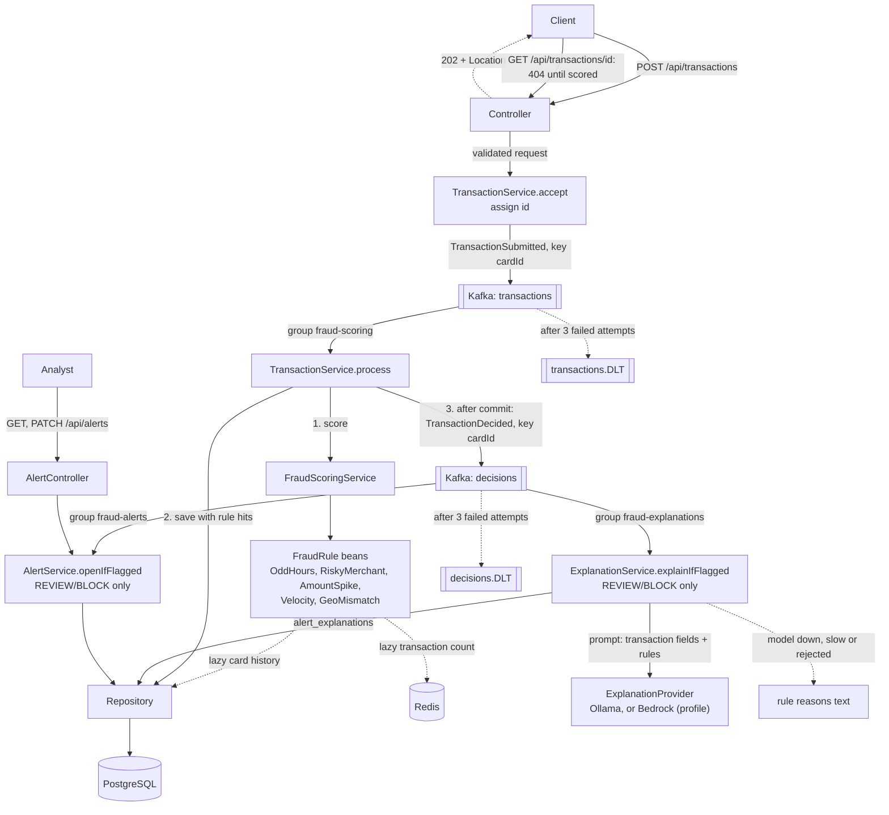

# Fraud Detection

[](https://github.com/PerumallaSG2/fraud-detection/actions/workflows/ci.yml)

A REST API that scores card transactions for fraud. A client POSTs a transaction (card, amount, merchant,
category, location, timestamp); it is queued on Kafka and the API answers `202 Accepted` right away. A consumer runs
it through a set of rules, adds up the points of the rules that fired into a risk score from 0 to 100, and decides:
APPROVE, REVIEW (a person should look at it) or BLOCK. The score, decision and the rules that fired are stored in
PostgreSQL, where the client fetches them. Every REVIEW or BLOCK opens an alert, which an analyst resolves as FRAUD or
FALSE_POSITIVE, and gets a short plain-English explanation written by an LLM (Ollama locally, or Claude on Amazon
Bedrock), or built from the rule reasons when no model is available. The AI explains; it never decides.

One Spring Boot application with a rules engine, Kafka between ingestion, scoring, alerts and explanations,
PostgreSQL, and Redis for the velocity counter. Micrometer metrics are scraped by Prometheus and shown on a
provisioned Grafana dashboard. A k6 load test measures throughput and latency on a laptop (see
[Load test](#load-test)).

## Architecture



- `controller`: HTTP, validation, error responses. It never touches repositories.
- `messaging`: the events, topic names, the publisher, and three thin listeners that hand each message to a service
  (the role a controller plays for HTTP).
- `service`: `TransactionService` accepts (publishes) and processes (scores, saves, publishes the decision);
  `FraudScoringService` runs the rules and maps the score to a decision; `AlertService` opens, lists and resolves
  alerts; `ExplanationService` writes each flagged transaction's explanation.
- `explanation`: the `ExplanationProvider` interface, its Ollama and Bedrock implementations, the prompt builder,
  the output checks and the rule-reasons fallback.
- `rules`: one class per rule, each implementing `FraudRule`. A new rule is a new class; the engine is unchanged.
- `repository`, `domain`: Spring Data JPA and the entities. DTOs are separate records and entities are never returned.

## Rules and scoring

Score is the sum of the points of triggered rules, capped at 100.

| Rule | Triggers when | Default points |
|---|---|---|
| `AMOUNT_SPIKE` | Amount is more than 3.0 x the average of the card's last 20 non-BLOCK transactions. With fewer than 5 such transactions, it triggers above 5000. | 40 |
| `RISKY_MERCHANT` | Merchant category is GAMBLING, CRYPTO or WIRE_TRANSFER (case-insensitive). | 30 |
| `ODD_HOURS` | Local hour is in [00:00, 05:00), read in the timestamp's own UTC offset. | 20 |
| `VELOCITY` | The card has more than 5 transactions in the 60 seconds ending at this transaction's timestamp, counting this one (so the 6th within 60s). Blocked attempts count. If Redis is down the rule does not fire (fails open). | 40 |
| `GEO_MISMATCH` | "Impossible travel": the distance from the card's previous non-BLOCK transaction (haversine), divided by the time between the two transactions' own timestamps, is above 900 km/h. Hops under 50 km never trigger. | 40 |

| Score | Decision |
|---|---|
| below 40 | APPROVE |
| 40 to 70 (both inclusive) | REVIEW |
| above 70 | BLOCK |

Points, thresholds, the score cap, the risky categories, the odd-hours window, the spike parameters, the velocity limit and window, and the geo-mismatch speed limit and minimum distance are all under
`fraud.*` in `src/main/resources/application.yml`.

## Tech stack

Java 21, Spring Boot 3.5.6, Maven, Spring Data JPA (Hibernate), Bean Validation, Flyway, PostgreSQL 16,
Redis 7 (Spring Data Redis, Lettuce), Apache Kafka 3.9 (Spring for Apache Kafka; one KRaft node, `apache/kafka`
image), Ollama (`llama3.2:1b`, optional), AWS SDK for Java 2 (`bedrockruntime`, Converse API, only with the
`bedrock` profile), Spring Boot Actuator, Micrometer with the Prometheus registry, Prometheus 3.15 and Grafana 13.3
(optional, Compose profile `monitoring`), Docker Compose, k6 (load test). Tests use JUnit 5, Mockito, AssertJ, Awaitility and Testcontainers
(PostgreSQL, Redis, Kafka).

## How to run

Needs Java 21, Maven and Docker. Kafka must be running to accept transactions (without it POST returns `503`).
Redis must be running for velocity to count; without it the app still scores, but the velocity rule never fires and
a WARN is logged. Ollama is optional: without it, explanations are built from the rule reasons (see
[Explanations](#explanations)).

```
docker compose up -d --wait   # Postgres 16 on host port 5433, Redis 7 on 6380, Kafka on 9094
mvn spring-boot:run           # app on localhost:8080; Flyway creates the schema, the app creates the topics
```

Add `--profile monitoring` to also start Prometheus and Grafana (see [Metrics](#metrics)):
`docker compose --profile monitoring up -d --wait`, and the same flag on `down`.

Submit a transaction:

```
curl -i -X POST localhost:8080/api/transactions -H 'Content-Type: application/json' -d '{
  "cardId":"c1","amount":120.50,"merchant":"Casino","merchantCategory":"GAMBLING",
  "city":"Austin","latitude":30.27,"longitude":-97.74,"timestamp":"2026-10-25T02:30:00-05:00"}'
```

Response: `202 Accepted` with a `Location` header. The transaction is queued, not scored yet (copied from a run
against local Docker Compose):

```
HTTP/1.1 202
Location: http://localhost:8080/api/transactions/6fd73df6-d22e-4cf6-b629-3ef46ddedb74

{"id":"6fd73df6-d22e-4cf6-b629-3ef46ddedb74","status":"PENDING"}
```

`202` is sent only after Kafka has acknowledged the write (`acks=all`), so an accepted transaction is not lost. If
Kafka can't be reached, POST returns `503` ("Transaction could not be accepted, try again") within about 3 seconds
and nothing is queued, so the client can retry. A `400` (validation) publishes nothing.

Poll the `Location`. It is `404` until the transaction is scored (usually a few milliseconds; in that run the 5th
poll, 50 ms apart, got it), then `200` with the decision (`400` if the id is not a UUID):

```
curl localhost:8080/api/transactions/6fd73df6-d22e-4cf6-b629-3ef46ddedb74
```

```
{
  "id": "6fd73df6-d22e-4cf6-b629-3ef46ddedb74",
  "cardId": "c1",
  "amount": 120.50,
  "merchant": "Casino",
  "merchantCategory": "GAMBLING",
  "city": "Austin",
  "latitude": 30.27,
  "longitude": -97.74,
  "timestamp": "2026-10-25T02:30:00-05:00",
  "riskScore": 50,
  "decision": "REVIEW",
  "triggeredRules": [
    {"rule": "RISKY_MERCHANT", "points": 30, "reason": "Merchant category GAMBLING is high risk"},
    {"rule": "ODD_HOURS", "points": 20, "reason": "Transaction at 02:30 local time is within odd hours (00:00-05:00)"}
  ],
  "createdAt": "2026-10-31T18:51:21.890440Z"
}
```

A `404` means "not scored yet", "unknown id" or "dead-lettered" (see below); the API doesn't tell them apart. There is
no PENDING row in the database: writing one would put PostgreSQL back on the POST path and make POST write to two
systems that can disagree.

### Alerts

A REVIEW or BLOCK transaction opens an alert, a moment after the transaction is scored (a separate consumer reads
the decision from Kafka). Each alert carries its `explanation` once one is written ([Explanations](#explanations)). List alerts newest first, optionally by status (`OPEN`, `FRAUD`,
`FALSE_POSITIVE`; all statuses if omitted). `page` starts at 0 and `size` is 1 to 100 (default 20):

```
curl 'localhost:8080/api/alerts?status=OPEN&page=0&size=20'
```

```
{
  "alerts": [
    {"id": "2a4cc410-3208-4763-a891-7598dd568eff", "transactionId": "5959ab81-d710-4c6e-8371-eb1d434e351b",
     "cardId": "c5", "riskScore": 50, "decision": "REVIEW", "status": "OPEN", "note": null,
     "createdAt": "2026-10-31T19:42:07.435504Z", "resolvedAt": null,
     "explanation": {
       "text": "Flagged for REVIEW (score 50): Merchant category GAMBLING is high risk; Transaction at 02:30 local time is within odd hours (00:00-05:00).",
       "source": "RULES", "model": null, "createdAt": "2026-10-31T19:42:07.473143Z"}},
    {"id": "1a8608ca-8461-4bd2-aefc-461d7a720083", "transactionId": "6fd73df6-d22e-4cf6-b629-3ef46ddedb74",
     "cardId": "c1", "riskScore": 50, "decision": "REVIEW", "status": "OPEN", "note": null,
     "createdAt": "2026-10-31T18:51:21.947538Z", "resolvedAt": null, "explanation": null}
  ],
  "page": 0, "size": 20, "totalElements": 2, "totalPages": 1
}
```

(Copied from a run without Ollama, hence `RULES`. The second alert was created before explanations existed; see
[alerts created before explanations](#alerts-created-before-explanations).)

Resolve an OPEN alert as `FRAUD` or `FALSE_POSITIVE`, with an optional note of up to 500 characters. The response is
the updated alert (`200`). An unknown id is `404`; an alert that is already resolved is `409`, and its first outcome is kept:

```
curl -X PATCH localhost:8080/api/alerts/{id} -H 'Content-Type: application/json' \
  -d '{"status":"FRAUD","note":"Cardholder confirmed the card was stolen"}'
```

Errors share one shape: `{status, error, message, fieldErrors}`, where `fieldErrors` is `[{field, message}]` and is
empty except for validation errors. Responses never include stack traces. Stop with `docker compose down`
(add `-v` to delete the data). DB settings can be overridden with `DB_HOST`, `DB_PORT`, `DB_USER`, `DB_PASSWORD`, and
Redis with `REDIS_HOST`, `REDIS_PORT`, and Kafka with `KAFKA_HOST`, `KAFKA_PORT` (default 9094, so it doesn't clash
with a local Kafka on 9092). Kafka keeps no volume: topics and offsets are gone after `docker compose down`.

## Explanations

Every REVIEW or BLOCK transaction gets a short plain-English explanation for the analyst, returned inside its alert
(`GET /api/alerts`, `PATCH /api/alerts/{id}`) as `explanation: {text, source, model, createdAt}`:

| `source` | Written by | `model` |
|---|---|---|
| `OLLAMA` | A local model through Ollama's HTTP API (default) | `llama3.2:1b` |
| `BEDROCK` | A model on Amazon Bedrock through the Converse API (`bedrock` profile) | e.g. `global.anthropic.claude-haiku-5-5` |
| `RULES` | No model: the decision, score and rule reasons, joined | `null` |

- **AI explains, never decides.** Explanations are written by their own consumer group on `decisions`
  (`fraud-explanations`), after the transaction is scored and saved. Nothing on the scoring path calls a model, so
  scoring speed and decisions don't depend on one, and the explanation code can only read transactions and write
  `alert_explanations`: it can't change a score, a decision or an alert. A hanging model delays only explanations
  (an end-to-end test checks that scoring and the alert are unaffected).
- **Always an explanation.** If the model isn't running (connection refused at once), times out (5 s for Ollama,
  10 s for Bedrock), errors, is cut off or refuses, or its answer is rejected, the explanation is built from the rule
  reasons instead (`RULES`). So the app works without any model.
- **Prompt.** Only the transaction's fields (amount, merchant, category, city, local time, score, decision) and its
  triggered rules with their reasons. No card or transaction id.
- **Prompt injection.** Merchant, city and the rule reasons come from the client (the geo-mismatch reason contains
  both cities), so they are untrusted: control characters and newlines are stripped, each is capped (100 characters,
  300 for a reason), and they are sent as one JSON block, so a quote or newline can't break out of its string. The
  fixed instructions say the block is data and never instructions, and that the decision and score are final.
- **Output checks.** Whitespace is collapsed and the text capped at 500 characters (at a sentence or word
  boundary). An answer is rejected, and the rule reasons used, if it is blank, contains a link, mentions approving, or
  says "blocked" for a REVIEW, so a model can't contradict the decision.
- **Idempotent.** One explanation per transaction (primary key `transaction_id`); a redelivered decision is skipped.
  Explanations have their own table, keyed by transaction, because the alert and explanation consumers aren't ordered
  relative to each other, but the transaction always exists first. The alert list fetches a page's explanations in one
  extra query.

### Ollama (default)

```
ollama pull llama3.2:1b   # about 1.3 GB; not in Docker Compose, to save disk (and native is faster on a Mac)
ollama serve              # if it isn't already running as an app; then mvn spring-boot:run as usual
```

Settings are under `fraud.explanations.ollama` (`OLLAMA_URL`, default `http://localhost:11434`). The first request
after Ollama starts loads the model and can exceed the 5 s timeout; that one explanation falls back to `RULES`, and
`keep_alive` keeps the model loaded afterwards.

### Amazon Bedrock (optional)

```
SPRING_PROFILES_ACTIVE=bedrock AWS_REGION=us-east-1 mvn spring-boot:run
```

- The default model is **Claude Haiku 5.5**, the cheapest Claude model on Bedrock, through its global cross-Region
  inference profile `global.anthropic.claude-haiku-5-5`. AWS doesn't offer it with in-Region invocation, and the
  global profile has no regional pricing premium. Its access has to be enabled in the Bedrock console (Model access).
- The provider uses the **Converse API**, which AWS lists as supported for Claude Haiku 5.5 on the `bedrock-runtime`
  endpoint, and sends nothing model-specific (no temperature, no extra fields). So any Converse model works by changing
  `fraud.explanations.bedrock.model-id` (or `BEDROCK_MODEL_ID`), with no code change.
- Credentials come from the default AWS chain (environment, profile, SSO, instance role). One retry at most, within
  the 10 s timeout. Only text blocks of the answer are used; a reasoning block is skipped, and any stop other than
  `end_turn` (`max_tokens`, `content_filtered`, `guardrail_intervened`) falls back to `RULES`.

### Alerts created before explanations

There is no backfill migration, since explanations need a model call rather than SQL. The new consumer group starts at
the earliest retained offset, so on its first start it explains every REVIEW/BLOCK decision still in `decisions`
(Kafka keeps 7 days by default). Alerts whose decisions are no longer retained keep `explanation: null`. Locally the
Kafka container has no volume, so after it is recreated (`docker compose down`, or compose recreating it) old
decisions are gone; that is why the second alert above has none. Within retention, a manual backfill is safe
(the consumer is idempotent):

```
docker exec fraud-kafka /opt/kafka/bin/kafka-consumer-groups.sh --bootstrap-server localhost:9092 \
  --group fraud-explanations --topic decisions --reset-offsets --to-earliest --execute   # with the app stopped
```

`explanation: null` on a new alert means it is not written yet (usually milliseconds after the alert, up to the
model timeout).

## Delivery guarantees

- **At least once.** The scoring consumer commits a message's offset only after it has scored, saved and published
  the decision. A crash or failure anywhere before that redelivers the message.
- **Idempotent consumers.** A redelivered transaction whose id is already saved is not scored or saved again; its
  decision is just published again (in case the earlier attempt saved and then failed to publish). The alert consumer
  skips decisions whose transaction already has an alert, and the unique `transaction_id` stops a racing duplicate.
  The Redis velocity entry is keyed by transaction id, so a retry isn't counted twice.
- **Decision after commit.** `decisions` is published only after the transaction row commits, so the alert consumer
  always finds the row (the alert has a foreign key to it). No outbox table is needed: redelivery covers a lost
  publish.
- **Retry, then dead-letter.** A failing message is retried in place 3 times in total, 1 second apart; then it goes to
  `<topic>.DLT` (same partition, with the exception and original offset in its headers), an ERROR is logged and the
  partition moves on. A message that can't be deserialized goes there at once. A dead-lettered transaction stays
  `404`. Replaying a DLT is manual for now.
- **Explanations** follow the same rules: their consumer is idempotent and shares the retry and dead-letter handling
  (a failed record goes to `decisions.DLT` with its consumer group in the headers, so a replay targets only
  `fraud-explanations`). A model failure never reaches the retries: it falls back to the rule reasons instead. At most
  10 records per poll, so even a model hanging to its timeout on each can't push a poll past
  `max.poll.interval.ms` and trigger a rebalance.
- **Per-card ordering.** Both topics are keyed by card id, so one card's messages share a partition, and each
  partition is consumed by one thread in offset order. The producer is idempotent, so its own retries can't reorder,
  and retries are blocking (no retry topics), so a failing message can't be overtaken. This matters because the spike
  baseline and geo mismatch read the card's previously saved transactions: the results match what a synchronous API
  would give for the same arrival order. Across cards nothing is ordered, and nothing needs it. Changing the
  partition count (`fraud.messaging.partitions`, 3) of existing topics re-maps cards and breaks this once.

### Trade-offs of going asynchronous

Gains: POST's latency and availability depend only on Kafka, not on PostgreSQL, Redis or scoring cost; bursts queue
in Kafka instead of piling onto the database; scoring scales with partitions and consumers; a failing alert no
longer fails or rolls back scoring; events can be replayed, and new consumers can subscribe without touching POST.

Costs:

- The caller doesn't get the decision in the response and has to poll. That suits post-authorization monitoring,
  not inline card authorization, which needs a synchronous answer.
- Eventual consistency: GET is `404` briefly, and alerts lag behind transactions. Before, a transaction and its
  alert were one database transaction; now they are joined by redelivery.
- At-least-once delivery makes every consumer idempotent.
- Poison messages and outages land in a DLT that someone has to watch and replay. Known limit: a long database
  outage dead-letters everything that arrives during it, not only bad messages.
- Blocking retries hold up a failing message's partition (about a third of the cards) for about 2 seconds.
- One more piece of infrastructure (about 217 MB of image, a 256 MB heap) and slower, asynchronous tests.

## Metrics

The app publishes Micrometer metrics at `GET /actuator/prometheus` (Prometheus text format). Actuator exposes only
`health`, `info` and `prometheus`; everything else (`env`, `beans`, `metrics`, `heapdump`, ...) is `404`. Every meter
carries the tag `application="fraud-detection"`.

| Prometheus name | Labels | Counts |
|---|---|---|
| `fraud_transactions_accepted_total` | | POSTs answered `202` (stored in Kafka); a `503` or `400` is not counted |
| `fraud_decisions_total` | `decision` = APPROVE, REVIEW, BLOCK | Newly scored transactions, after the database commit. A redelivered message whose transaction is already saved is not counted again |
| `fraud_rule_hits_total` | `rule` = the five rule names | One per rule that fired on a newly scored transaction |
| `fraud_scoring_seconds` (histogram: `_bucket`, `_count`, `_sum`, `_max`) | `le` | Time to run every rule against one transaction, history query and Redis included. Every attempt is timed, retries too |
| `fraud_dead_letters_total` | `topic` = `transactions.DLT`, `decisions.DLT` | Records stored on a dead-letter topic (counted after the send is acknowledged) |
| `fraud_explanations_total` | `source` = OLLAMA, BEDROCK, RULES | Explanations saved; `RULES` is the fallback when the model failed or its answer was rejected |
| `fraud_velocity_fail_open_total` | | Scorings where Redis was unavailable, so velocity could not fire |
| `kafka_consumer_fetch_manager_records_lag_max`, `..._records_lag` | `client_id` = `consumer-<group>-<n>`, plus `topic`/`partition` on `records_lag` | Kafka client metrics, bound by Spring Boot: records behind the end of the partition |

Every label value comes from a small fixed set. Card ids, transaction ids, merchants and cities are never labels (a
test POSTs a transaction and checks that neither its card id nor its id appears anywhere in the scrape). Spring
Boot's `http_server_requests_seconds` uses the URI template (`/api/transactions/{id}`), not the path. Known labels
are registered at 0 at startup, so every series exists before the first transaction.

Percentiles: the scoring timer is a histogram (buckets from 1 ms to 5 s), so p50/p95/p99 are computed in Prometheus
with `histogram_quantile`, which also aggregates correctly across instances. The Prometheus registry doesn't export
client-side percentiles next to a histogram, so there are none.

Consumer lag is what each consumer measured at its last fetch, so it is only reported by a consumer that is running:
if a consumer dies, its series disappears instead of growing. Watching committed-offset lag per group would need a
separate poller (or an exporter) using the Kafka admin API; not built.

### Prometheus and Grafana

```
docker compose --profile monitoring up -d --wait   # also Prometheus on localhost:9091, Grafana on localhost:3001
mvn spring-boot:run
```

- Prometheus (`prom/prometheus:v3.15.1`) scrapes `host.docker.internal:8080/actuator/prometheus` every 5 s
  (`monitoring/prometheus.yml`), keeps 1 day, and has no volume.
- Grafana (`grafana/grafana:13.3.0-slim`) gets its Prometheus datasource and the **Fraud detection** dashboard from
  `monitoring/grafana/provisioning`, so both are there with no setup: open
  <http://localhost:3001/d/fraud-overview>. Anonymous users can view it. To edit, log in as `admin` with the
  password from `GRAFANA_ADMIN_PASSWORD` (default `admin`, for local use only; set it anywhere else, e.g.
  `GRAFANA_ADMIN_PASSWORD=... docker compose --profile monitoring up -d --wait`). The dashboard is read-only in the
  UI; change the JSON file instead. No volume: Grafana state goes away on `down`.
- Panels: accepted/s, decisions/s by outcome, rule hits/s by rule, scoring p50/p95/p99, dead-lettered messages by
  topic, explanations/s by source, velocity fail-open, consumer lag per consumer.
- Host ports are `PROMETHEUS_PORT` (9091) and `GRAFANA_PORT` (3001), away from the usual 9090 and 3000.
- Both images are about 420 MB to download and about 1.5 GB on disk (Grafana 1.15 GB, Prometheus 357 MB), which is
  why they sit behind a profile and a plain `docker compose up` doesn't pull them. Remove them with
  `docker image rm grafana/grafana:13.3.0-slim prom/prometheus:v3.15.1`.

`/actuator/prometheus` has no authentication. That's fine on a laptop; in production, serve Actuator on a separate
management port that only the scraper can reach.

## Load test

A [k6](https://k6.io) script (`load-test/fraud-load.js`) POSTs transactions at a fixed arrival rate, rising in
stages, and the numbers below come from running it on one laptop. **They are laptop numbers, not production
capacity:** k6, the app, PostgreSQL, Kafka, Redis, Prometheus and Grafana all shared the same 8 cores.

```
brew install k6
docker compose --profile monitoring up -d --wait
mvn -DskipTests package && java -jar target/fraud-detection-0.0.1-SNAPSHOT.jar
load-test/run.sh smoke                       # 10/s for 20 s: checks the script and the expected decisions
load-test/run.sh steps                       # 25, 50, 100, 200, 400, 800, 1600 /s; STEPS=900,1000 for others
RATE=700 load-test/run.sh sustain            # stages up to RATE, then a 5 minute hold (HOLD_S)
```

`run.sh` runs k6, waits until every transaction has a decision, then prints end-to-end times and the dashboard's
numbers per stage. Its output goes to `load-test/results/` (git-ignored; the Kafka dumps reach about 100 MB per run, so delete
it afterwards). The rows it creates all have card ids starting with `lt-`.

### Setup

| | |
|---|---|
| Machine | MacBook, Apple M2 (8 cores), 8 GB RAM, macOS 26.5. The step runs were on battery (Low Power Mode off), the sustained run on AC power |
| Docker | Docker Desktop 4.54, engine 29.1.2, VM with 8 CPUs and 3.8 GB |
| App | `java -jar` (OpenJDK 21.0.10, default flags: G1, max heap 2 GB = 1/4 of RAM), default profile, not the test profile. Not `mvn spring-boot:run`, which starts the JVM with `-XX:TieredStopAtLevel=1` (no C2 JIT), a startup setting that would understate throughput |
| Settings | All defaults from `application.yml`: 3 partitions per topic, 3 listener threads per consumer group, producer `acks=all`, Hikari pool 10, Tomcat 200 threads |
| Explanations | Ollama not running, so every REVIEW/BLOCK explanation fell back to the rule reasons at once. Explanations are off the scoring path |
| Load | Open model (`ramping-arrival-rate`): k6 starts requests at the target rate however slow the app is. Each stage ramps for 15 s and then holds for 60 s; numbers are from the hold only |

The data is built so rules fire only where intended:
- Card ids rotate over 100,000 cards, so a card comes back at most once a minute even at 1,600/s, and velocity never fires.
- Each card has a fixed city (no geo mismatch) and a base amount varied by ±25% (never 3× its average, so no spike).
- Timestamps are "now" in an offset where the local time is midday (no odd hours).
- In every 100 transactions:
  - 2 are REVIEW: GAMBLING at 02:xx local, 30 + 20 = 50.
  - 1 is BLOCK: the same plus 9,000.00, which adds the amount spike, 90.

Every run got exactly that mix (97.0% / 2.0% / 1.0% of decisions, counted from the `decisions` topic). The only rule hits were RISKY_MERCHANT, ODD_HOURS and AMOUNT_SPIKE, and
the sampled transactions (below) were never given a different decision than expected.

### How it is measured

- **POST latency and throughput.** k6's `http_req_duration` for `POST /api/transactions`, and the rate of `202`
  responses. A `202` means Kafka acknowledged the record (`acks=all`), so this is the API plus the Kafka write.
- **End-to-end, POST to decision: from Kafka record timestamps, with no polling.** Polling every transaction with GET
  would add load to the same app and database, and the result would depend on the poll interval. So after the run
  `load-test/e2e-latency.py` reads both topics and computes, for **every** transaction, the `decisions` record's
  timestamp minus the `transactions` record's timestamp. Both are stamped by the app's own producer (one clock). The
  decision is published right after the scored row is committed, which is when `GET /api/transactions/{id}` starts
  returning it. Not included: the time between the POST arriving and its record being written, which is part of the
  POST latency above (under 1 ms p50 here).
- **Client-side check: sampled GET.** A second k6 scenario POSTs 2 transactions per second of its own and polls each
  one with GET until it is scored. It polls every 25 ms for the first second, then every 250 ms. Each sample
  includes the POST, the GET and up to one poll interval of waiting. That added about 26 GET/s on average in step
  run 1, small next to the load.
- **Dashboard.** `load-test/capture-metrics.py` runs the Grafana dashboard's own panel queries (read from
  `fraud-overview.json`, sent through Grafana's `/api/ds/query`) over each hold. It also runs a few Prometheus queries
  for finding the bottleneck: Spring Kafka's listener and template timers, Hikari, CPU and GC. `docker stats` and
  `ps` are sampled every 5 s.

### Results: steps

From step run 2 (25 to 1,000/s) and step run 1 (the 1,600/s row). Each ran against a newly started app (run 1 after a
20 s smoke run), so the JVM was warmed up only by the stages before it. Step run 2 went on to 1,100,
1,200 and 1,300/s, but Docker Desktop was quit partway through 1,100/s, so those stages are left out. In the rows they have in common (25 to 800) the
two runs agree to within a few ms at p95, except one: at 800/s, end-to-end p95 was 63 ms in run 2 and 43 ms in run 1.

| Target /s | Achieved /s | POST p50 / p95 / p99 (ms) | Errors | End-to-end p50 / p95 / p99 (ms) | Sampled e2e p50 / p95 (ms) | Scoring p95 (ms) | Scoring threads busy |
|---:|---:|---|---:|---|---|---:|---:|
| 25 | 25.0 | 2.9 / 5.8 / 7.5 | 0 | 7 / 14 / 20 | 33 / 38 | 4.1 | 0.06 |
| 50 | 50.0 | 1.7 / 3.8 / 6.4 | 0 | 5 / 10 / 25 | 31 / 36 | 2.6 | 0.09 |
| 100 | 100.0 | 1.1 / 1.6 / 2.6 | 0 | 3 / 4 / 7 | 29 / 30 | 1.3 | 0.10 |
| 200 | 200.0 | 0.7 / 1.2 / 1.9 | 0 | 2 / 3 / 6 | 28 / 28 | 1.0 | 0.14 |
| 400 | 400.0 | 0.4 / 0.8 / 1.7 | 0 | 2 / 4 / 11 | 26 / 27 | 1.0 | 0.22 |
| 800 | 800.0 | 0.5 / 1.0 / 2.3 | 0 | 3 / 63 / 113 | 27 / 81 | 1.3 | 0.61 |
| 900 | 900.0 | 0.6 / 1.1 / 2.3 | 0 | 10 / 168 / 256 | 27 / 160 | 1.4 | 0.80 |
| 1,000 | 1000.0 | 0.6 / 1.2 / 2.8 | 0 | 545 / 1,500 / 1,708 | 576 / 1,522 | 1.4 | 0.98 |
| 1,600 | 1590.5 | 0.7 / 3.7 / 19.7 | 0 | 35,349 / 45,023 / 45,962 | 18,687 / 28,559 | 2.0 | 0.99 |

- Errors means a non-`202` POST. Dead letters were 0 in every stage.
- Scoring threads busy is `rate(spring_kafka_listener_seconds_sum)` per `fraud-scoring` listener thread, averaged
  over the hold: seconds spent in the listener per second, where 1.0 is busy all the time. Scoring p95 is the
  dashboard's `histogram_quantile` over `fraud_scoring_seconds` (rules only).
- At 1,600/s:
  - k6 fell 572 requests short of the target (552 `dropped_iterations` over the run).
  - Velocity failed open once: one Redis call timed out at 200 ms.
  - 55 sampled transactions weren't scored within the sampler's 30 s limit.
  - Every transaction still got a decision once the load stopped.
- Sampled end-to-end is higher than the Kafka-timestamp number at low load. That gap is the sampler's own POST and
  GET plus up to 25 ms of poll interval, which is why it isn't the main measurement.
- POST latency is higher at 25/s than at 400/s. At low rates the JVM is still warming up (these were the first
  stages after startup), and connections sit idle between requests.

### Where it starts to struggle, and why

**Up to 800/s it keeps up:** every transaction is decided in 3 ms at the median. **At 900/s queueing starts:** the
p95 goes from 63 ms to 168 ms while the median stays at 10 ms. **At 1,000/s it can't keep up:** end-to-end
p95 is 1.5 s and grows through the hold. At 1,600/s the API still takes everything with no errors (POST p99 is
under 20 ms), but decisions top out at about 780/s and the backlog grows by about 760 records a second. By the end of
the hold the dashboard shows about 15,000 records of lag per scoring partition.

**The bottleneck is the scoring consumer: 3 threads, one record at a time each.** Evidence from the dashboard queries:
- **Scoring threads are saturated.** Busy is 0.80 per thread at 900/s, 0.98 at 1,000/s and 0.99 at 1,600/s. The
  `fraud-alerts` and `fraud-explanations` listener threads never went above 0.06.
- **The ceiling matches the arithmetic.** At 1,000/s each record took 3.0 ms in the listener, so 3 threads can do
  about 3 / 3.0 ms ≈ 1,000/s. At 1,600/s it was 3.8 ms per record, so about 790/s, and decisions were measured at
  about 780/s.
- **Not the rules.** Scoring p95 is 1.4 ms at 1,000/s, under half of the 3.0 ms per record. Most of a record's time
  is the rest of `TransactionService.process`:
  - the saved-id check and history query,
  - the insert with its rule hits and the commit, round trips to PostgreSQL in the Docker VM,
  - the decision publish it waits for (0.5 ms average).
- **Not the database pool.** Hikari peaked at 5 active connections of 10 at 1,000/s (6 at 1,600/s), with 0 pending at
  every stage.
- **Not CPU, at the knee.**
  - At 1,000/s the app used 12% of all cores (`process_cpu_usage`, about 1 core) and the laptop 76%
    (`system_cpu_usage`).
  - In `docker stats`, Kafka was about 1.3 cores and PostgreSQL about 0.6 cores.
  - Per-record time does grow with load (1.7 ms at 400/s, 3.0 ms at 1,000/s, 3.8 ms at 1,600/s), because
    everything on the laptop slows down as it fills up.
- **Not the API or the Kafka write.** POST p95 stayed at or under 1.2 ms through 1,000/s, with no 503s.
- **The cap is the partition count.** A partition goes to one thread, so `fraud.messaging.partitions` (3) sets the
  maximum parallelism.

**What would likely raise the limit (not done here):**
- more partitions with matching listener concurrency (per-card order is kept, since cards are keyed);
- batching the inserts and commits;
- not waiting for each decision's publish on the scoring thread.

**A caveat on the lag panel.** At 1,000/s the dashboard's lag panel stayed at 0, even though transactions waited
1.5 s. `records_lag_max` is measured from the consumer's position, and the position moves forward as soon as `poll()` hands
a batch to the listener thread (up to `max.poll.records`, 500), before those records are processed. So a backlog that
fits in one batch per thread doesn't show up as lag. Lag only appeared once the backlog outgrew that (at 1,600/s). End-to-end time is the signal to watch. Also, `records_lag_max` keeps its last
value for a while after the consumer goes idle.

### Results: sustained

700/s is 70% of the 1,000/s knee. The run ramps through 175, 350 and 525/s, 30 s each, then holds 700/s for
5 minutes. It ran twice, on AC power, after a fresh `docker compose down`/`up` and app start.

| | Run 2 (nothing else running) | Run 1 |
|---|---:|---:|
| Transactions in the hold | 209,987 (700.0/s) | 209,827 (699.4/s) |
| POST p50 / p95 / p99 / max (ms) | 0.4 / 1.1 / 2.8 / 85 | 0.4 / 1.2 / 3.7 / 255 |
| Errors (non-`202`), dead letters | 0, 0 | 0, 0 |
| `dropped_iterations` (whole run) | 13 | 172 |
| End-to-end p50 / p95 / p99 / max (ms) | 2 / 61 / 448 / 683 | 2 / 100 / 685 / 1,124 |
| Without a decision after the run | 0 | 0 |
| Scoring p95, dashboard (ms) | 1.3 | 1.4 |
| Scoring threads busy, avg / max of 20 s windows | 0.52 / 0.81 | 0.53 / 0.93 |
| Consumer lag (dashboard) | 0 | 0 |
| Hikari active max / pending | 4 / 0 | 3 / 0 |
| Velocity fail-open | 0 | 0 |

It holds 700/s: no errors, no dead letters, every transaction decided, median end-to-end 2 ms. The tail is not
flat, though. End-to-end p95 per 30 s of run 2's hold:

| 30 s window | 1 | 2 | 3 | 4 | 5 | 6 | 7 | 8 | 9 | 10 |
|---|---:|---:|---:|---:|---:|---:|---:|---:|---:|---:|
| p95 (ms) | 18 | 235 | 246 | 28 | 17 | 20 | 20 | 20 | 46 | 541 |

Seven of the ten windows have p95 between 17 and 46 ms. The other three come in two bursts of 30–60 s, with p95 up
to 541 ms (p99 640). What was measured during the bursts:
- The scoring listener's time per record went up to 2.8–3.2 ms (20 s averages), against about 2.0 ms the rest of the
  hold.
- Laptop CPU rose to about 70%.
- GC pauses stayed flat (about 2 ms/s).
- PostgreSQL checkpoints run continuously (each spread over 270 s), so they don't line up with the bursts.

The cause isn't pinned down. At 700/s the three scoring threads have little headroom (0.52 busy on average), so any
slowdown of the shared laptop shows up straight away as queueing.

Run 1 had the same shape. Its last 30 s (p95 799 ms) overlapped with a 100 MB Python parse of the step runs' Kafka
dumps on the same laptop. That's why it was rerun.

## Testing

`mvn test` runs 186 tests, all passing at the last run (0 skipped). It needs Docker: tests that touch the database run
against real PostgreSQL 16 (`postgres:16-alpine`, the same image as Docker Compose), the full-app tests also against
Kafka (`apache/kafka:3.9.2`, same as Compose) and the velocity tests against Redis, all through Testcontainers.
Without Docker every container test fails rather than skips. No test needs Ollama or AWS: both are replaced by a
local stub HTTP server (the JDK's built-in `HttpServer`), and the Bedrock tests run the real AWS SDK client against
it with fake credentials. Rule, service, mapper, explanation and controller tests use no containers and take well
under a second in total.

| Layer | Tests | Covers |
|---|---|---|
| Rules | 39 | Each rule's boundaries, offsets, case-insensitivity, history baseline, BLOCK exclusion; velocity limit, one count call, empty count; geo distance, speed limit, out-of-order timestamps |
| Scoring service | 13 | Point sum, rule order, cap at 100, decisions at 39/40/70/71, history lookup excludes BLOCK, velocity count and fail-open on Redis errors (counted; a working Redis is not), every scoring timed |
| Transaction service and mapper | 12 | Accept publishes under the returned id and is counted, publish failure propagates and is not; process scores then saves then publishes after commit, rule hits, an already saved id is not rescored but republished, scoring failure saves and publishes nothing; decision and each rule hit counted after commit, not for an already saved id or a failed scoring; 404, 2-decimal amounts |
| Alert service | 12 | REVIEW/BLOCK open an alert and APPROVE doesn't, a redelivered decision opens no second alert, newest-first paging with and without status, explanations added with one lookup per page (none for an empty page), resolve returns the explanation, 404, 409 keeps the first outcome |
| Explanations (no containers) | 33 | Prompt has only transaction fields and rules, no ids; injected quotes and newlines stay inside their JSON string; caps; output cleaning, 500-character cap, rejecting blank, links, approval, "blocked" for a REVIEW; rule-reasons text; service: APPROVE and already-explained skipped, model answer saved with source and model, failure or rejected answer falls back (each counted by source), never changes the transaction; Ollama against a stub (request body, 500, no answer, timeout, not running); Bedrock Converse against a stub (path, body without temperature, reasoning skipped, non-`end_turn` stops, errors); exactly one provider per profile |
| Repositories (`@DataJpaTest`, real PostgreSQL) | 11 | Save/load with ordered rule hits, offset round trip, history query; alert save/load, status filter with newest-first paging, one alert per transaction, exists by transaction; explanation save/load, a second one for the same transaction rejected (not merged) |
| Velocity counter (`@DataRedisTest`, real Redis) | 9 | Window bounds, transaction timestamps, cards isolated, same id counted once, old entries dropped, TTL |
| Controllers (`@WebMvcTest`) | 25 | 202 with `Location` and PENDING body, 503 when Kafka doesn't accept, 400 cases (nothing published), 404, 405, 500 without leaked details; alert list params and shape with and without an explanation, PATCH 200/400/404/409 |
| End to end (`@SpringBootTest`, real HTTP, Kafka and PostgreSQL) | 7 | POST 202 then GET round trip, offset kept through Kafka, rule order, spike scenario, blocked baseline, impossible travel (velocity mocked) |
| Alerts end to end (real HTTP, Kafka and PostgreSQL) | 5 | REVIEW and BLOCK open alerts, APPROVE doesn't, newest first, resolve then 409, 404 |
| Explanations end to end (real HTTP, Kafka, PostgreSQL, Ollama stub) | 5 | REVIEW explained by the model with score and decision unchanged; an Ollama error and a contradicting answer fall back to the rule reasons; a hanging model delays neither scoring nor the alert; APPROVE gets none |
| Kafka processing (real Kafka and PostgreSQL) | 5 | A duplicated message is scored, saved and alerted once; a transient failure is retried with nothing dead-lettered; a permanent one is dead-lettered after 3 attempts and the partition moves on; unreadable JSON is dead-lettered unscored (both counted on `fraud_dead_letters_total`, the retried one not); one card's 10 transactions are processed in order |
| Velocity end to end (real HTTP, Kafka, PostgreSQL and Redis) | 3 | 6th within 60s fires and reviews, timestamp not server time, blocked attempts count |
| Metrics (no containers) | 2 | Every decision, rule, source and dead-letter topic registered at 0; counters move by tag |
| Metrics end to end (real HTTP, Kafka and PostgreSQL) | 3 | A REVIEW moves accepted, decision, rule-hit, scoring and explanation meters; `/actuator/prometheus` serves every metric name including Kafka consumer lag, and neither the card id nor the transaction id; only `health`, `info` and `prometheus` exposed |
| Application context | 2 | Context loads, health endpoint |

Every database test runs Flyway's V1 to V4 on a fresh PostgreSQL 16 and Hibernate validates the schema against it,
so the suite checks the same SQL and types that production uses. Each distinct Spring test context starts its own
containers. The full-app tests share one context (`AbstractKafkaIntegrationTest`, which also owns the one Ollama
stub), so one Kafka serves them all; the velocity tests have their own (real Redis), and with it their own Kafka, so
the two contexts' consumers never take each other's messages. That context points Ollama at a closed port, so its
explanations fall back to the rule reasons.

## Key design decisions

- **Blocked transactions are excluded from the spike baseline.** A fraudulent amount that was blocked must not raise
  the average and make the next large amount look normal. An end-to-end test covers this.
- **Score before save.** The transaction is scored first and saved after, in one database transaction, so it
  never counts toward its own baseline.
- **Lazy history in `RuleContext`.** Rules do not inject repositories. The context carries a lookup function that
  runs the query only if a rule asks for history. It is always built with the BLOCK-excluding query.
- **Local offset for odd hours.** 02:30 at -05:00 is 02:30 for the cardholder, not 07:30 UTC. Jackson's default
  conversion to UTC is turned off, and V2 stores the original offset, so GET returns the timestamp as submitted.
- **Amounts with more than 2 decimals are rejected (400), not rounded,** so the scored amount and the stored amount
  are always identical.
- **Flyway owns the schema.** Hibernate only validates. Schema changes are new `V<n>` files; applied ones are never edited.
- **Thresholds live in one place** (`FraudProperties`, bound from `application.yml`), not in rules or services.
- **Velocity fails open.** If Redis is down, the velocity rule is skipped with a WARN and the other rules still
  score, so a cache outage doesn't decline every customer. The health endpoint shows Redis as down.
- **Velocity counts blocked attempts.** Card testing is many fast attempts that get blocked, so they must count.
  This is the opposite of the spike baseline, which excludes them.
- **Alerts are opened by a Kafka consumer of `decisions`,** not in the scoring transaction. A failing alert no
  longer rolls back the transaction; instead the decision is retried and, after 3 attempts, dead-lettered to
  `decisions.DLT`, where it can be replayed.
- **Kafka's JSON uses the application's `ObjectMapper`.** spring-kafka's own mapper would shift timestamps to UTC
  and break odd hours; an end-to-end test checks the offset survives.
- **Alerts copy the card, score and decision** from their transaction, so the list needs no join (only one extra
  query per page for the explanations). One alert per transaction (unique `transaction_id`).
- **An alert is resolved once.** Resolving locks the row (`SELECT ... FOR UPDATE`), so of two concurrent resolves the
  second gets `409`. `OPEN` is not a valid resolution.
- **One id per transaction.** The id is generated before scoring and used as both the Redis entry and the database
  key. The Redis update runs as one Lua script, so concurrent requests for the same card can't miscount. Known limit:
  if the save fails after scoring and the message ends up dead-lettered, that attempt stays counted for up to 60
  seconds. (A retry that succeeds isn't counted twice: same id.)

## Roadmap

Not built yet:

- Client idempotency key, so a retried request is not scored, counted or stored twice
- Splitting ingestion, scoring and alerts into separate deployable services (they are already decoupled by Kafka)
- Replaying dead-lettered messages
- Replaying a Kaggle fraud dataset through the API

