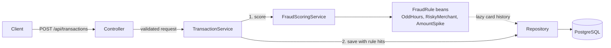

# Fraud Detection

A REST API that scores card transactions for fraud in real time. A client POSTs a transaction (card, amount,
merchant, category, location, timestamp). The service runs it through a set of rules, adds up the points of the
rules that fired into a risk score from 0 to 100, and returns a decision: APPROVE, REVIEW (a person should look at
it) or BLOCK. The score, decision and the rules that fired are stored in PostgreSQL, so every decision can be
retrieved and explained later.

This is Phase 1: one Spring Boot application with a rules engine and PostgreSQL. There is no Kafka, Redis or ML yet.

## Architecture



- `controller`: HTTP, validation, error responses. It never touches repositories.
- `service`: `TransactionService` orchestrates; `FraudScoringService` runs the rules and maps the score to a decision.
- `rules`: one class per rule, each implementing `FraudRule`. A new rule is a new class; the engine is unchanged.
- `repository`, `domain`: Spring Data JPA and the entities. DTOs are separate records and entities are never returned.

## Rules and scoring

Score is the sum of the points of triggered rules, capped at 100.

| Rule | Triggers when | Default points |
|---|---|---|
| `AMOUNT_SPIKE` | Amount is more than 3.0 x the average of the card's last 20 non-BLOCK transactions. With fewer than 5 such transactions, it triggers above 5000. | 40 |
| `RISKY_MERCHANT` | Merchant category is GAMBLING, CRYPTO or WIRE_TRANSFER (case-insensitive). | 30 |
| `ODD_HOURS` | Local hour is in [00:00, 05:00), read in the timestamp's own UTC offset. | 20 |

| Score | Decision |
|---|---|
| below 40 | APPROVE |
| 40 to 70 (both inclusive) | REVIEW |
| above 70 | BLOCK |

Points, thresholds, the score cap, the risky categories, the odd-hours window and the spike parameters are all under
`fraud.*` in `src/main/resources/application.yml`.

## Tech stack

Java 21, Spring Boot 3.5.6, Maven, Spring Data JPA (Hibernate), Bean Validation, Flyway, PostgreSQL 16,
Spring Boot Actuator, Docker Compose. Tests use JUnit 5, Mockito, AssertJ and H2.

## How to run

Needs Java 21, Maven and Docker.

```
docker compose up -d --wait   # Postgres 16 on host port 5433
mvn spring-boot:run           # app on localhost:8080; Flyway creates the schema
```

Score a transaction:

```
curl -i -X POST localhost:8080/api/transactions -H 'Content-Type: application/json' -d '{
  "cardId":"c1","amount":120.50,"merchant":"Casino","merchantCategory":"GAMBLING",
  "city":"Austin","latitude":30.27,"longitude":-97.74,"timestamp":"2026-10-25T02:30:00-05:00"}'
```

Response: `201 Created` with a `Location: /api/transactions/{id}` header and this body (copied from a run against
local Postgres; whitespace added):

```
{
  "id": "d24588fd-f85d-44b1-ae64-86d51a6b09ea",
  "cardId": "c1",
  "amount": 120.50,
  "merchant": "Casino",
  "merchantCategory": "GAMBLING",
  "city": "Austin",
  "latitude": 30.27,
  "longitude": -97.74,
  "timestamp": "2026-10-25T02:30:00-05:00",
  "riskScore": 50,
  "decision": "REVIEW",
  "triggeredRules": [
    {"rule": "ODD_HOURS", "points": 20, "reason": "Transaction at 02:30 local time is within odd hours (00:00-05:00)"},
    {"rule": "RISKY_MERCHANT", "points": 30, "reason": "Merchant category GAMBLING is high risk"}
  ],
  "createdAt": "2026-10-26T19:22:37.955980Z"
}
```

Fetch it again (`404` if unknown, `400` if the id is not a UUID):

```
curl localhost:8080/api/transactions/d24588fd-f85d-44b1-ae64-86d51a6b09ea
```

Errors share one shape: `{status, error, message, fieldErrors}`, where `fieldErrors` is `[{field, message}]` and is
empty except for validation errors. Responses never include stack traces. Stop with `docker compose down`
(add `-v` to delete the data). DB settings can be overridden with `DB_HOST`, `DB_PORT`, `DB_USER`, `DB_PASSWORD`.

Do not check output by piping curl through `python3 -m json.tool`: it parses numbers as floats and prints `120.5`.

## Testing

`mvn test` runs 61 tests, all passing at the last run. No Docker is needed.

| Layer | Tests | Covers |
|---|---|---|
| Rules | 20 | Each rule's boundaries, offsets, case-insensitivity, history baseline, BLOCK exclusion |
| Scoring service | 7 | Point sum, cap at 100, decisions at 39/40/70/71, history lookup excludes BLOCK |
| Transaction service and mapper | 9 | Scoring happens before save, rule hits, 404, 2-decimal amounts |
| Repository (`@DataJpaTest`) | 5 | Save/load with rule hits, offset round trip, history query |
| Controller (`@WebMvcTest`) | 12 | 201 and `Location`, 400 cases, 404, 405, 500 without leaked details |
| End to end (`@SpringBootTest`, real HTTP) | 6 | POST/GET round trip, spike scenario, blocked baseline |
| Application context | 2 | Context loads, health endpoint |

Caveat: tests run on H2 in PostgreSQL mode, using the same Flyway migrations. H2 is not PostgreSQL, so a difference
in types or SQL behavior would not show up in the suite. Against real Postgres I have only run the app by hand:
it starts with V1 and V2 applied and passes schema validation, and one POST and GET returned correct output. The
returned offset on GET was not checked there. There are no Testcontainers tests yet.

## Key design decisions

- **Blocked transactions are excluded from the spike baseline.** A fraudulent amount that was blocked must not raise
  the average and make the next large amount look normal. An end-to-end test covers this.
- **Score before save.** The transaction is scored first and saved after, in one `@Transactional` method, so it
  never counts toward its own baseline.
- **Lazy history in `RuleContext`.** Rules do not inject repositories. The context carries a lookup function that
  runs the query only if a rule asks for history. It is always built with the BLOCK-excluding query.
- **Local offset for odd hours.** 02:30 at -05:00 is 02:30 for the cardholder, not 07:30 UTC. Jackson's default
  conversion to UTC is turned off, and V2 stores the original offset, so GET returns the timestamp as submitted.
- **Amounts with more than 2 decimals are rejected (400), not rounded,** so the scored amount and the stored amount
  are always identical.
- **Flyway owns the schema.** Hibernate only validates. Schema changes are new `V<n>` files; applied ones are never edited.
- **Thresholds live in one place** (`FraudProperties`, bound from `application.yml`), not in rules or services.

## Roadmap

Not built yet:

- Velocity and geo-mismatch rules, with Redis for counters
- Kafka, splitting ingestion and scoring into separate services
- AI-generated explanations of decisions with Ollama (Bedrock optional)
- Testcontainers tests against real PostgreSQL
- Prometheus and Grafana monitoring
- k6 load tests
- Replaying a Kaggle fraud dataset through the API

## How I built this

I built this with Claude Code, mainly to learn how to use an AI coding agent the
way I would on a team: plan first, build in small steps, and review everything
before committing.

How I worked:
- I put the project rules in CLAUDE.md: layering, one class per rule, tests for
  every feature, and ask before adding libraries.
- I had it plan Phase 1 in plan mode and reviewed the plan before any code was written.
  It asked four questions; I chose comparing spikes to the card's own history,
  Flyway for the schema, summing rule points, and using the timestamp's own offset
  for odd hours.
- Then I built it in 10 small steps, each with tests and its own commit.

What I changed during review:
- The plan averaged a card's recent transactions including blocked ones. Repeated
  blocked fraud attempts would raise the average and hide the next one, so blocked
  transactions are excluded from the baseline.
- The first spike rule injected the repository directly, which went against the
  plan. I had history passed in through RuleContext instead, so rules never touch
  the database and are tested with plain data.
- Amounts with more than 2 decimals were being rounded, so the rules scored one
  number and the database stored another. Now they're rejected with a 400.
- Testing by hand on Postgres showed POST and GET returning timestamps differently,
  so I added a V2 migration to store the original offset.

What the tests caught:
- Jackson was converting request timestamps to UTC, so 2:30 AM in Cincinnati reached
  the odd-hours rule as 7:30 AM. The unit tests passed; the controller test caught it.

What I'd do next:
- Tests run on H2. I'd move the integration tests to real Postgres with Testcontainers.
